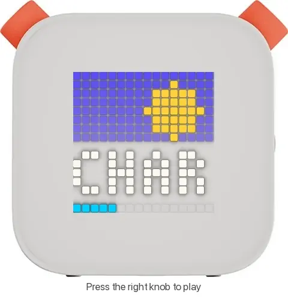
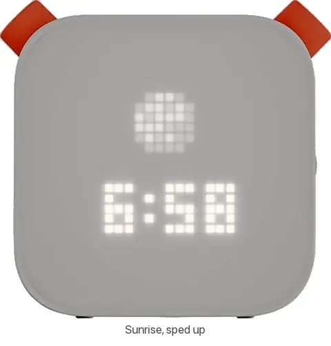
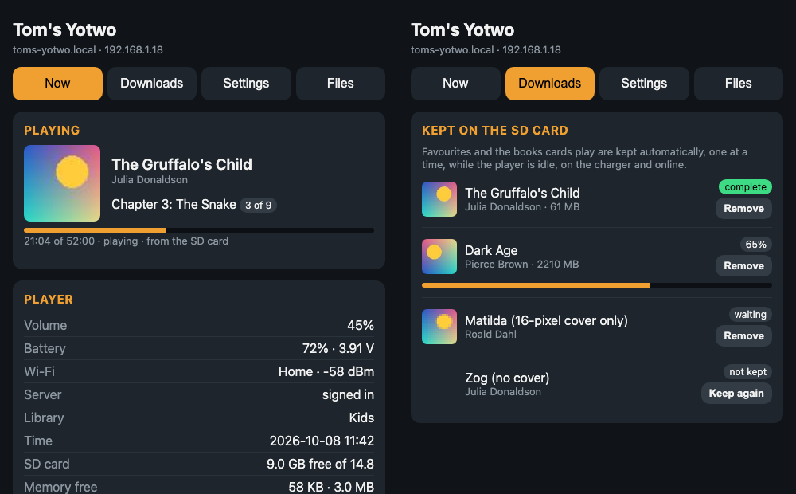
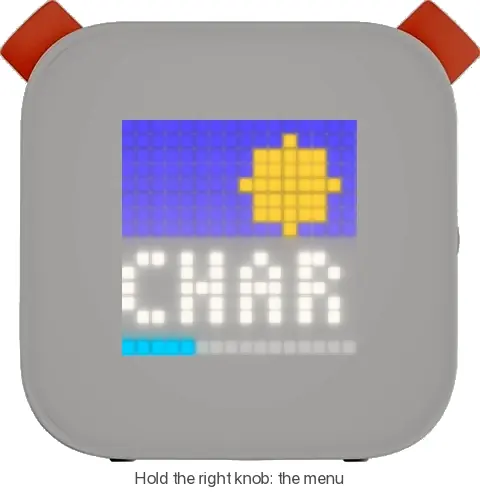
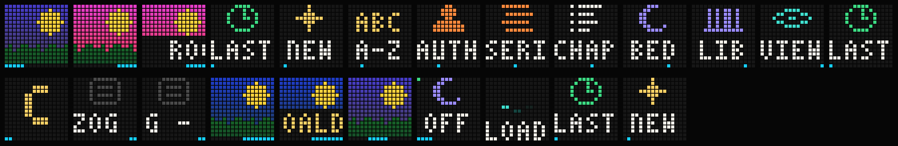
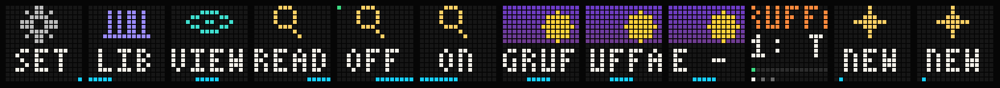
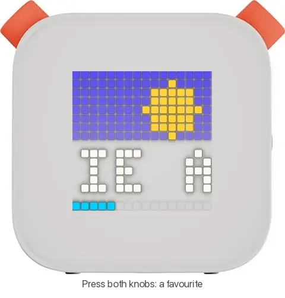
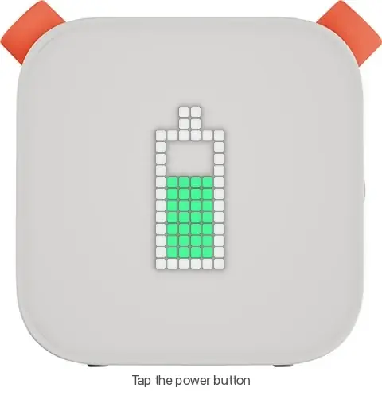

# yotwo

**Custom firmware that turns a Yoto Player (Gen 2) into an
[Audiobookshelf](https://www.audiobookshelf.org/) player.**

Browse and play your whole Audiobookshelf library from the player itself with
the two knobs. No cards and no cloud are needed. Everything is local, on your
own server.

<table>
  <tr>
    <td align="center"> Browse with a knob</td>
    <td align="center"> Play, volume, chapters</td>
    <td align="center"> Sunrise clock</td>
  </tr>
</table>

Recorded from the desktop simulator, which runs the player's own UI code at its real speed, and laid over a mock-up of the player (`tools/ui_sim/make_gifs.sh`). Covers are placeholders in the simulator.

<!-- PHOTO TO ADD: the player running yotwo, e.g. docs/media/photo-player.jpg -->
> **[Photo to add: a yotwo player in use]**

> **Status: beta.** It is in daily use on two players and fairly stable. It
> hasn't been fully kid-tested yet, and the UX in particular still needs
> refining. Installing it means opening the player and soldering; see
> [Getting started](#getting-started).

**[What it does](#what-it-does) · [Compared with the original](#yotwo-compared-with-the-original-firmware) · [Getting started](#getting-started) · [Using yotwo](#using-yotwo) · [Documentation](#documentation)**

---

## Why

My kids love their Yotos, and I love Audiobookshelf. As they get older they
want more say in what they listen to, without me making cards and adding
artwork every time. All our audiobooks already live on Audiobookshelf, and
uploading everything to Yoto's servers was a pain.

I had a couple of old Gen 2 players that are no longer supported. I wanted
something local and under my control, where the kids could browse and pick
books themselves, while keeping what makes the Yoto such a good audio player.
There are projects for the Yoto Mini ([Adafruit's guide](https://learn.adafruit.com/hacking-the-yoto-music-players),
[open-yoto](https://github.com/tensorfish/open-yoto)), but nothing for the
big Gen 2 player. So this is that.

## What it does

- **Your whole Audiobookshelf library on the player.** Browse by recently
  played, newest, favourites, downloaded, title (A–Z), author or series.
  Switch between libraries. Cover art is shown at 16 × 16.
- **Favourites.** Press both knobs to make a book a favourite. Favourites are
  mirrored to a "Favourites" collection on Audiobookshelf.
- **Downloads and offline mode.** Favourites and card books download to the SD
  card in the background, while the player is idle and on the charger. If
  Wi-Fi drops it carries on with what's downloaded, and listening progress
  syncs back when it reconnects.
- **Cards are optional.** Link any NFC card to a book with both knobs. Nothing
  is written to the card: original Yoto cards, blank NTAG stickers and the
  like all work. A **sleep card** dims the screen, starts a sleep timer and
  carries on where you left off.
- **A clock** with a slow sunrise and sunset, so kids can see the sun come up
  on the screen. The **LED ring** works as a nightlight (turn the player face
  down) and as a sunrise wake-up light.
- **Settings on the player:** scroll speed, an easier-to-read mode for
  long names, day and night brightness, sleep timer, volume limit, automatic
  switch-off, cover or text lists.
- **A web page on the player** (`http://yotwo.local`): what's playing,
  downloads, cards, settings, the Audiobookshelf sign-in, a file browser for
  the SD card, a display test, and firmware updates.
- **Over-the-air updates** from that web page. A new version gets a trial
  run, and if it doesn't start up properly the player goes back to the
  previous one by itself.
- Battery display, headphone detection, the accelerometer and auto switch-off
  are all supported, roughly on a par with the original firmware's features.

  

## yotwo compared with the original firmware

| | Original Yoto firmware | yotwo |
|---|---|---|
| **Where content comes from** | Yoto's servers: Yoto cards, Make Your Own cards, Yoto's own streams | Your own [Audiobookshelf](https://www.audiobookshelf.org/) server. Nothing from Yoto |
| **Accounts and cloud** | Needs a Yoto account; the player talks to Yoto's cloud | Local only. The player talks to your Audiobookshelf server and nothing else (plus an internet time server for the clock) |
| **Choosing what to play** | Put in a card | Browse your whole library on the player with the knobs: recent, new, favourites, downloaded, A–Z, author, series. Switch libraries |
| **Cards** | Yoto cards and Make Your Own cards (content set up through Yoto) | **Optional.** Link **any NFC card** (an old Yoto card, a blank sticker…) to any book with both knobs. Nothing is written to the card |
| **Routine cards** | — | A sleep card: dims the screen, starts a sleep timer, carries on where you left off |
| **Favourites** | — | Both knobs; mirrored to a collection on Audiobookshelf |
| **Offline** | Card content is cached once played | Favourites and card books download in the background; positions sync back when Wi-Fi returns |
| **Listening position** | On the player, per card | Synced with Audiobookshelf, so you can carry on in the Audiobookshelf app (and the other way round) |
| **Settings** | In the Yoto app | On the player, or on its own web page (`http://yotwo.local`) |
| **Pictures** | Pixel art for each chapter | The book's cover, scaled to 16 × 16, plus the chapter number |
| **Clock and lights** | Clock, alarms, nightlight, day/night brightness | Clock with a gradual sunrise and sunset, sunrise wake light, face-down nightlight, day/night brightness. No alarms yet |
| **Bluetooth** | Can be used as a Bluetooth speaker | Not supported |
| **Updates** | From Yoto, while the Gen 2 was supported | From [Releases](https://github.com/tomekent/yotwo/releases), uploaded on the player's web page, with automatic roll-back |
| **Installing** | Comes on the player | Open the player and flash it over a serial cable, once |
| **Going back** | — | Restore the backup you take before installing |

## Limits

- **Installing it is the hard part.** You open the player, solder a header to
  the board and use a USB-to-serial adapter. This is a one-off: after that,
  updates go over Wi-Fi.
- **16 × 16 pixels is tiny.** That's the Yoto's charm, but titles have to
  scroll. The scroll speed is adjustable, and an "easier to read" mode
  shortens names.
- **No per-chapter pictures.** It shows the book's cover plus the chapter
  number.
- **You need your own Audiobookshelf server.** It does not play Yoto's
  content or Make Your Own cards.
- **Sign in with an API key.** With a username and password, Audiobookshelf
  sessions expire. The player can keep the password, encrypted, to sign
  itself back in, but an API key is the better option.
- **No Bluetooth headphones.** This ESP32 doesn't have the memory for
  Bluetooth and Wi-Fi together, which is probably why the original firmware
  never enabled it on the Gen 2 either.
- See the [roadmap](docs/roadmap.md) for what's still to do.

## Getting started

You will need:

- A **Yoto Player, 2nd generation**: the full-size one with the 16 × 16
  pixel display and the charging dock. Second-hand ones are cheap. Not the
  Mini; the Gen 3 is untested.
- A **3.3 V USB-to-serial adapter** (CP2102, CH340, FT232…), a soldering
  iron, header pins and a few jumper wires.
- Two push buttons for a small **boot/reset board** (optional: a jumper wire
  works too).
- An **Audiobookshelf server** on your network, or reachable from it.

The steps, in full in **[docs/getting-started.md](docs/getting-started.md)**:

1. [Open the player and solder a serial header](docs/getting-started.md#1-open-the-player-and-solder-a-header)
2. [Make a boot/reset board, or use a jumper wire](docs/getting-started.md#2-a-way-into-bootloader-mode)
3. [Back up the original firmware](docs/getting-started.md#3-back-up-the-original-firmware) (strongly recommended)
4. Install yotwo, either way:
   - **[Flash a release](docs/getting-started.md#4a-flash-a-release)**: download it from
     [Releases](https://github.com/tomekent/yotwo/releases) and run one script, or
     esptool by hand. No toolchain needed.
   - **[Build from source](docs/building.md)** with ESP-IDF 5.5.2, then flash your build.
5. [Set up Wi-Fi and sign in to Audiobookshelf](docs/getting-started.md#5-first-start-wi-fi-and-sign-in)

After that, **updates are over Wi-Fi**: download `yotwo-<version>.bin` from
[Releases](https://github.com/tomekent/yotwo/releases) and upload it on the
player's web page (Settings → Firmware).

## Using yotwo

The display is 16 × 16 pixels, so everything is a picture with up to four
characters at a time. Longer names scroll along the bottom.

### The knobs and buttons

| | Turn | Press | Hold |
|---|---|---|---|
| **Left knob** | Volume | Play / pause | |
| **Right knob**, on the player screen | Chapter screen: turn to pick a chapter, press to go there | Open the menu | Show the clock |
| **Right knob**, in lists and menus | Move | Choose | Back one level |
| **Both knobs together** | | Favourite / unfavourite the book shown (or playing). With an unlinked card in the slot: link the card to that book | |
| **Power button** | | A tap shows the battery | Switch off |

Switching on with **both knobs held** goes back to the previous firmware
version (see [Updating later](docs/getting-started.md#updating-later)).

### The menu

Press the right knob on the player screen:

| Item | Shows |
|---|---|
| `LAST` | Books you've played, most recent first |
| `NEW` | The 50 most recently added |
| `FAV` | Your favourites in this library |
| `DOWN` | Books downloaded to the SD card (playable offline) |
| `A-Z` | The alphabet: pick a letter to jump into all titles there |
| `AUTH` | Authors, then their books |
| `SERI` | Series, then their books in order |
| `BED` | Sleep timer: off, 15, 30 or 60 minutes |
| `SET` | Settings, below |

Every list looks the same: a picture on top (the cover, or an icon), the name
along the bottom, and a thin cyan line showing where you are in the list.
Lists wrap round. A green dot in the top-left corner marks what's in use, and
a small red heart marks a favourite.

### Settings (`SET`)

| Setting | Does |
|---|---|
| `LIB` | Switch Audiobookshelf library |
| `VIEW` | Lists as cover art (`ART`) or text (`TEXT`) |
| `READ` | Easier-to-read names: "The Gruffalo" becomes "Gruffalo, The", and "Chapter 12: The Wand" becomes "12: The Wand" |
| `SPD` | How fast names scroll: `MIN`, `SLOW`, `MED`, `FAST` |
| `CARD` | The card in the slot: make it a sleep card, or forget it |
| `EXT` | How long taking a sleep card out and back in extends the timer |
| `CLK` | Clock: `HOUR` (12/24-hour), `RISE` and `DUSK` (sunrise and sunset times), `FADE` (how long each takes) |
| `BRT` | Display brightness by day and by night |
| `AUTO` | Switch off on battery after a while (or never) |
| `VOL` | Volume limit |
| `LITE` | LED ring: nightlight on/off, colour, brightness, sunrise wake light |
| `WIFI` | Start Wi-Fi setup again (shows the setup code; any button leaves) |

### Favourites and downloads

Press both knobs on a book to make it a favourite (a heart swells) or to
unfavourite it (an empty heart shrinks). Favourites are mirrored to a
"Favourites" collection on your Audiobookshelf server, so they also show up
in the Audiobookshelf apps.

Favourites, and books linked to cards, are **downloaded to the SD card** in
the background, one at a time, while the player is idle, on the charger and
online. The web page's Downloads tab shows progress and lets you remove
copies.

**Offline:** when Wi-Fi has been gone for 20 seconds, a crossed-out Wi-Fi
symbol appears and every list shows only downloaded books. Positions are sent
back to the server when Wi-Fi returns.

### Cards

Cards are optional. Nothing is written to a card: the player remembers the
card's ID. Original Yoto cards, blank NTAG stickers and most other NFC tags
work.

- **Book card:** put an unlinked card in the slot, find a book (in a list, or
  play it), and press both knobs. From then on, putting the card in plays that
  book, even from another library, and taking it out pauses.
- **Sleep card:** with the card in the slot, `SET` → `CARD` → `SLP`, then
  choose the minutes. Putting it in dims the display, starts the sleep timer
  and carries on with the last book. Taking it out pauses; putting it back
  resumes. If the timer has run out, taking it out and putting it back gives
  a few more minutes (`EXT`).
- **Forget a card:** `SET` → `CARD` → `CLR`, or *Unlink* on the web page.

### Clock and LED ring

With nothing playing and no knob touched for 30 seconds, the player shows a
clock. A sun or moon on top rises and sets with the sunrise and sunset times
in `CLK`, and the time is shown underneath. Hold the right knob on the player
screen to show it straight away. The time comes from the internet, so it needs
Wi-Fi after each switch-on.

**Nightlight:** turn the player face down and the display goes dark while the
ring lights in your chosen colour. Playback carries on.

**Wake light:** if turned on, the ring rises in warm orange with the clock's
sunrise and stays on for a few minutes. Any button turns it off. It needs the
player to be on: set `AUTO` to `NONE`, or leave it on the charger.

**Battery:** a tap of the power button shows the battery for three seconds,
and plugging in the charger shows it with a lightning bolt.

### The web page

Open **`http://yotwo.local`** from a device on the same network. With two
players, the second is `yotwo-2.local`.

| Tab | |
|---|---|
| **Now** | What's playing, battery, Wi-Fi, library, SD card, memory, version |
| **Downloads** | Books kept on the SD card, with progress; remove or keep again |
| **Cards** | Linked cards and what they play; unlink |
| **Settings** | Player name, display (brightness, test), scrolling, volume limit, switch-off, clock, nightlight and wake light, **Audiobookshelf server and sign-in**, **firmware update**, formatting the SD card |
| **Files** | Browse the SD card |

Changing the sign-in, updating firmware and formatting the card all ask for a
four-digit code shown on the player's display, so only someone holding the
player can do them.

The page is plain HTTP on your local network. It refuses requests from other
websites, but anyone on your network could read what it sends.

## Documentation

| | |
|---|---|
| [Using yotwo](#using-yotwo) | The knobs, menus, settings, cards, the web page, updates |
| [Getting started](docs/getting-started.md) | Opening the player, serial header, boot/reset board, backup, flashing, first setup, restoring the original firmware |
| [Building from source](docs/building.md) | Toolchain, build, tests, the UI simulator, making releases |
| [Hardware](docs/hardware.md) | The Gen 2 board: chips, pin map, IO expander, buses, power, cautions |
| [Firmware reference](docs/firmware.md) | How the firmware works, part by part, and what was confirmed on the player |
| [Journal](docs/journal.md) | How it was built, step by step |
| [Roadmap](docs/roadmap.md) | What's next |
| [Changelog](CHANGELOG.md) | What changed in each release |

## How it was made

I built this with a lot of help from Claude (Anthropic's AI assistant).
That covered the code, and also working out the hardware: the pin map,
display driver, NFC reader, charger lines and so on. It was surprisingly
quick to get to where it is, and well beyond what my own C skills would have
managed. The [journal](docs/journal.md) records how it went, step by step.

The Audiobookshelf client, player and download code is shared with my
[ABSpresso](https://github.com/tomekent/ABSpresso) player (an ESP32-S3
touchscreen device) and copied in by `tools/sync_abspresso.sh`.

Thanks to the [open-yoto](https://github.com/tensorfish/open-yoto) project and
[Adafruit's Yoto guide](https://learn.adafruit.com/hacking-the-yoto-music-players),
whose work on the Mini showed the way.

## Disclaimer

This project is not affiliated with, endorsed by or connected to Yoto
Limited. "Yoto" is their trademark and is used here only to say which
hardware this runs on.

Flashing custom firmware voids whatever warranty is left, and you do it at
your own risk. You could brick your player (keep the backup), and you are
working inside a device with a lithium battery.

The firmware is written from scratch and contains none of Yoto's code. The
original firmware was studied only to make this software work with hardware I
own, and no security measures were bypassed (the Gen 2 doesn't enable any).
For that reason this repository does not include the original firmware,
dumps of it, or notes on its internals. Please don't open issues or pull
requests adding them.

## License

[GPL-3.0](LICENSE), with an added permission to link Espressif's
binary-only libraries (see [NOTICE](NOTICE)). In short: you can use, change
and share yotwo, but if you distribute it, or anything built from it, you
must share the source of your version under the same licence.

The ESP-IDF components it pulls in at build time (including Espressif's
`esp_audio_codec`) come under their own licences.
