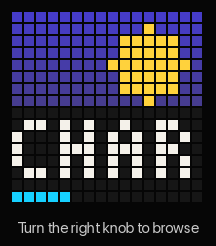

# yotwo

**Custom firmware that turns a Yoto Player (Gen 2) into an
[Audiobookshelf](https://www.audiobookshelf.org/) player.**

Browse and play your whole Audiobookshelf library from the player itself with
the two knobs. No cards and no cloud are needed. Everything is local, on your
own server.

<table>
  <tr>
    <td align="center"> Browse with a knob</td>
    <td align="center"> Play, volume, chapters</td>
    <td align="center"> Sunrise clock</td>
  </tr>
  <tr>
    <td align="center"> Menu and A–Z</td>
    <td align="center"> Favourites</td>
    <td align="center"> Cards (optional)</td>
  </tr>
</table>

Recorded from the desktop simulator, which runs the player's own UI code at its real speed (`tools/ui_sim/make_gifs.sh`).

<!-- PHOTO TO ADD: the player running yotwo, e.g. docs/media/photo-player.jpg -->
> **[Photo to add: a yotwo player in use]**

> **Status: beta.** It is in daily use on two players and fairly stable. It
> hasn't been fully kid-tested yet, and the UX in particular still needs
> refining. Installing it means opening the player and soldering; see
> [Getting started](#getting-started).

---

## Why

My kids love their Yotos, and I love Audiobookshelf. As they get older they
want more say in what they listen to, without me making cards and adding
artwork every time. All our audiobooks already live on Audiobookshelf, and
uploading everything to Yoto's servers was a pain.

I had a couple of old Gen 2 players that are no longer supported. I wanted
something local and under my control, where the kids could browse and pick
books themselves, while keeping what makes the Yoto such a good audio player.
There are projects for the Yoto Mini ([Adafruit's guide](https://learn.adafruit.com/hacking-the-yoto-music-players),
[open-yoto](https://github.com/tensorfish/open-yoto)), but nothing for the
big Gen 2 player. So this is that.

## What it does

- **Your whole Audiobookshelf library on the player.** Browse by recently
  played, newest, favourites, downloaded, title (A–Z), author or series.
  Switch between libraries. Cover art is shown at 16 × 16.
- **Favourites.** Press both knobs to make a book a favourite. Favourites are
  mirrored to a "Favourites" collection on Audiobookshelf.
- **Downloads and offline mode.** Favourites and card books download to the SD
  card in the background, while the player is idle and on the charger. If
  Wi-Fi drops it carries on with what's downloaded, and listening progress
  syncs back when it reconnects.
- **Cards are optional.** Link any NFC card to a book with both knobs. Nothing
  is written to the card: original Yoto cards, blank NTAG stickers and the
  like all work. A **sleep card** dims the screen, starts a sleep timer and
  carries on where you left off.
- **A clock** with a slow sunrise and sunset, so kids can see the sun come up
  on the screen. The **LED ring** works as a nightlight (turn the player face
  down) and as a sunrise wake-up light.
- **Settings on the player:** scroll speed, an easier-to-read mode for
  long names, day and night brightness, sleep timer, volume limit, automatic
  switch-off, cover or text lists.
- **A web page on the player** (`http://yotwo.local`): what's playing,
  downloads, cards, settings, the Audiobookshelf sign-in, a file browser for
  the SD card, a display test, and firmware updates.
- **Over-the-air updates** from that web page. A new version gets a trial
  run, and if it doesn't start up properly the player goes back to the
  previous one by itself.
- Battery display, headphone detection, the accelerometer and auto switch-off
  are all supported, roughly on a par with the original firmware's features.

  

## Limits

- **Installing it is the hard part.** You open the player, solder a header to
  the board and use a USB-to-serial adapter. This is a one-off: after that,
  updates go over Wi-Fi.
- **16 × 16 pixels is tiny.** That's the Yoto's charm, but titles have to
  scroll. The scroll speed is adjustable, and an "easier to read" mode
  shortens names.
- **No per-chapter pictures.** It shows the book's cover plus the chapter
  number.
- **You need your own Audiobookshelf server.** It does not play Yoto's
  content or Make Your Own cards.
- **Sign in with an API key.** With a username and password, Audiobookshelf
  sessions expire. The player can keep the password, encrypted, to sign
  itself back in, but an API key is the better option.
- **No Bluetooth headphones.** This ESP32 doesn't have the memory for
  Bluetooth and Wi-Fi together, which is probably why the original firmware
  never enabled it on the Gen 2 either.
- See the [roadmap](docs/roadmap.md) for what's still to do.

## Getting started

You will need:

- A **Yoto Player, 2nd generation**: the full-size one with the 16 × 16
  pixel display and the charging dock. Second-hand ones are cheap. Not the
  Mini; the Gen 3 is untested.
- A **3.3 V USB-to-serial adapter** (CP2102, CH340, FT232…), a soldering
  iron, header pins and a few jumper wires.
- Two push buttons for a small **boot/reset board** (optional: a jumper wire
  works too).
- An **Audiobookshelf server** on your network, or reachable from it.

The steps, in full in **[docs/getting-started.md](docs/getting-started.md)**:

1. [Open the player and solder a serial header](docs/getting-started.md#1-open-the-player-and-solder-a-header)
2. [Make a boot/reset board, or use a jumper wire](docs/getting-started.md#2-a-way-into-bootloader-mode)
3. [Back up the original firmware](docs/getting-started.md#3-back-up-the-original-firmware) (strongly recommended)
4. Install yotwo, either way:
   - **[Flash a release](docs/getting-started.md#4a-flash-a-release)**: download it from
     [Releases](https://github.com/tomekent/yotwo/releases) and run one script, or
     esptool by hand. No toolchain needed.
   - **[Build from source](docs/building.md)** with ESP-IDF 5.5.2, then flash your build.
5. [Set up Wi-Fi and sign in to Audiobookshelf](docs/getting-started.md#5-first-start-wi-fi-and-sign-in)

After that, **updates are over Wi-Fi**: download `yotwo-<version>.bin` from
[Releases](https://github.com/tomekent/yotwo/releases) and upload it on the
player's web page (Settings → Firmware).

## Documentation

| | |
|---|---|
| [Getting started](docs/getting-started.md) | Opening the player, serial header, boot/reset board, backup, flashing, first setup, restoring the original firmware |
| [Using yotwo](docs/using.md) | The knobs, menus, settings, cards, the web page, updates |
| [Building from source](docs/building.md) | Toolchain, build, tests, the UI simulator, making releases |
| [Hardware](docs/hardware.md) | The Gen 2 board: chips, pin map, IO expander, buses, power, cautions |
| [Firmware reference](docs/firmware.md) | How the firmware works, part by part, and what was confirmed on the player |
| [Journal](docs/journal.md) | How it was built, step by step |
| [Roadmap](docs/roadmap.md) | What's next |
| [Changelog](CHANGELOG.md) | What changed in each release |

## How it was made

I built this with a lot of help from Claude (Anthropic's AI assistant).
That covered the code, and also working out the hardware: the pin map,
display driver, NFC reader, charger lines and so on. It was surprisingly
quick to get to where it is, and well beyond what my own C skills would have
managed. The [journal](docs/journal.md) records how it went, step by step.

The Audiobookshelf client, player and download code is shared with my
[ABSpresso](https://github.com/tomekent/ABSpresso) player (an ESP32-S3
touchscreen device) and copied in by `tools/sync_abspresso.sh`.

Thanks to the [open-yoto](https://github.com/tensorfish/open-yoto) project and
[Adafruit's Yoto guide](https://learn.adafruit.com/hacking-the-yoto-music-players),
whose work on the Mini showed the way.

## Disclaimer

This project is not affiliated with, endorsed by or connected to Yoto
Limited. "Yoto" is their trademark and is used here only to say which
hardware this runs on.

Flashing custom firmware voids whatever warranty is left, and you do it at
your own risk. You could brick your player (keep the backup), and you are
working inside a device with a lithium battery.

The firmware is written from scratch and contains none of Yoto's code. The
original firmware was studied only to make this software work with hardware I
own, and no security measures were bypassed (the Gen 2 doesn't enable any).
For that reason this repository does not include the original firmware,
dumps of it, or notes on its internals. Please don't open issues or pull
requests adding them.

## License

[GPL-3.0](LICENSE), with an added permission to link Espressif's
binary-only libraries (see [NOTICE](NOTICE)). In short: you can use, change
and share yotwo, but if you distribute it, or anything built from it, you
must share the source of your version under the same licence.

The ESP-IDF components it pulls in at build time (including Espressif's
`esp_audio_codec`) come under their own licences.
