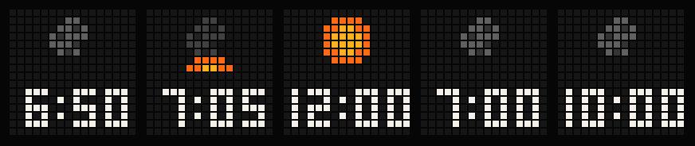
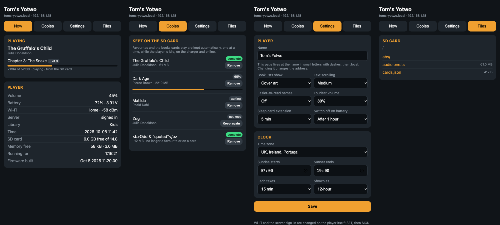

# The yotwo firmware

The technical reference for the firmware in `firmware/`: how it is put
together, what each part does, and what has and has not been confirmed on a
player. It is [ABSpresso](https://github.com/tomekent/ABSpresso)'s network
and app code running on a Yoto Gen 2 board layer, with a UI of its own.

This page grew alongside the [journal](journal.md), so parts of it read as a
lab notebook (results of each flash, in order). For using the player see
[using.md](using.md); for building see [building.md](building.md).

**Status: working on the player since 2026-10-05.** It sets up from a
phone, signs in, lists the library, and streams and plays a book chosen
with the knobs. See "Hardware results" below for what has been confirmed
and what has not.

## Building

```
tools/idf.sh build        # ESP-IDF v5.5.2, target esp32
tools/idf.sh size
```

`tools/idf.sh` loads the ESP-IDF environment and runs `idf.py` in
`firmware/`. It refuses `flash` and `erase` commands on purpose: the player
has no auto-reset, so flashing goes through `tools/flash.sh`. More in
[building.md](building.md).

Latest build, 2026-10-05: `yotwo.bin` is 1.86 MB (4 MB app partition,
56 % free). The first build measured static IRAM at 110 KB of 131 KB and
static DRAM at 47 KB.

## Hardware results

First flash 2026-10-05 (build `6364a1a-dirty`, 1.86 MB).

| Item | Result |
|---|---|
| Boots on rev 1 silicon with the PSRAM workaround | Yes |
| **PSRAM** | **8 MB device fitted**; the original ESP32 can only map 4 MB of it, so 4,096 KB is usable |
| Flash chip | Identifies as Boya; support now enabled in the build |
| I2C bus and **IO expander at `0x20`** | Responds (init succeeded) |
| **ES8388 at `0x10`** | Responds (all init register writes acknowledged) |
| Display init | Commands sent without error; the user read the setup password off the display, so text is legible. Colours and exact orientation not yet reported |
| Wi-Fi, setup network and portal | Working: a phone joined, the page was served, Wi-Fi credentials were tested and the player joined the home network |
| HTTPS to the Audiobookshelf server | Working (certificate validated); the first sign-in attempt was rejected by the server with HTTP 401 |
| **SD card** | **Failed in this build:** `no available dma channel`. The SD bus asked for DMA channel 1, which the display bus had already taken. Fixed in source (`SPI_DMA_CH_AUTO`); needs a reflash to test |
| Encoders | Two harmless errors at start-up: the pulse counter tries to enable a pull-up on GPIO 35, which has none. Knob behaviour not yet reported |
| Sign-in, library | Second sign-in attempt succeeded; 4 libraries found, 242 items loaded in about 10–13 s; 3.5 MB of PSRAM free afterwards |
| Knobs | A book was chosen and opened from the device, so the right knob's turn and press work. Which knob is which, and direction, not yet reported |
| **Playback** | **Crashed in this build** as the first segment arrived: `LoadStoreError` in `memcpy` from `esp_http_client_read` ← `abs_stream_read` ← `fetch_segment`. Cause below. Worked round in `main.c`; flashed in the second build |
| Audio output, battery reading, power latch on battery | Not yet observed |

**The playback crash.** The original ESP32 offers a 20 KB corner of
instruction RAM as heap. It supports only aligned 32-bit access, and it is
the first region `heap_caps_malloc()` tries for a plain
`MALLOC_CAP_INTERNAL` request. ABSpresso's player allocates its fetch and
decode buffers that way, which is fine on the ESP32-S3 (no such region) but
here returned `0x4009b074`, and the first byte copy into it faulted
(`EXCVADDR 0x4009b284`). Two fixes are in place:

- **In ABSpresso** (2026-10-05, at the user's request): the four
  allocations in `player.c` now ask for
  `MALLOC_CAP_INTERNAL | MALLOC_CAP_8BIT`. Harmless on the S3.
- **Here**, `main.c` still uses the IRAM heap region up at start-up
  (`reserve_iram_heap`), as a guard against the same trap in any other
  code or library.

Second flash 2026-10-05 (SD DMA fix, Boya flash support, IRAM heap
workaround), from the serial log of the session that followed:

| Item | Result |
|---|---|
| IRAM heap workaround | `reserved 20288 bytes of IRAM heap`; **no crash** in about six minutes of use |
| **SD card** | **Mounts**: the 16 GB card in the player, 11.3 GB free of 15.2 GB |
| **Streaming and decoding** | **Working.** Sessions opened at the server's saved position (one resumed at 28,842 s of a 73,606 s book with 92 chapters); the decoder reported 44.1 kHz stereo 16-bit and the audio output opened. About 3 s from opening a session to the first decoded audio |
| Seeking | Chapter skips restart the stream at the new position. One took 18 s to produce audio again (the server restarting its transcode); others about 3 s |
| Memory after loading the library | 138 KB internal and 3.5 MB PSRAM free |
| **Audible output** | **Confirmed by the user: sound works and playing a book works.** So the ES8388 register sequence, I2S pins, MCLK on GPIO 0 and the amplifier enable polarity are all right |

Third flash 2026-10-05 (browsing views, library switching, chapter titles):

| Item | Result |
|---|---|
| Library switching | Worked: the log shows a switch to the "Podcasts" library |
| **Knob buttons** | **Ghost presses**, reported by the user: menus changed on their own and hold seemed not to work. The log shows bursts of "both knobs pressed" a few hundred ms apart. Cause: the expander's **pull-ups were not enabled**, so the knob-button inputs floated. I had misread the stock code: it does write the pull-up registers on this board and only ignores *errors* from those writes. Fixed in source (registers `0x46`–`0x49`); needs a reflash |
| Task watchdog | Fired once, as a warning: core 0's idle task was starved for 5 s during a TLS handshake (elliptic-curve maths in `abs_sync`) while audio was decoding. Timeout raised to 15 s in the next build |
| A session close returned 404 | Seen once after the watchdog episode; the server had already dropped that session. Harmless |

Fourth flash 2026-10-05 (expander pull-ups):

| Item | Result |
|---|---|
| **Knob buttons** | **Fixed**, confirmed by the user: no more ghost presses |
| **Audio quality** | **Problem reported by the user: occasional stutter, or sounding clipped.** Not yet diagnosed; no serial log was available (the adapter was unplugged). The next build turns on the player's once-a-second pipeline statistics and makes three changes that might help (below) |

Changes in the build after that, **none yet confirmed to cure the
stutter**:

- I2S buffer enlarged from the default (about 32 ms) to about 185 ms, in
  case short stalls in the decoder were reaching the speaker as gaps.
- Mono streams are sent to both codec channels explicitly. (**This change
  was wrong and made mono books play at half speed**; see the fifth flash.)
- The display rewrites only the driver chips whose rows changed, cutting
  I2C/SPI traffic while the screen is mostly static.
- `PLAYER_STATUS_LOG` defined, so the log shows buffer fill, decode
  errors, slowest audio write and underruns each second.

Fifth flash 2026-10-05 (cover art, settled player screen, audio
investigation changes), from the user's report and the log:

| Item | Result |
|---|---|
| **Cover art** | User: "covers look decent". One cover failed to decode (`esp_jpeg` error 8, an unsupported JPEG variant; 4,682 bytes); that book falls back to `CH` + number |
| **Mono books** | **Broken by my change in this build**: a mono book (The BFG, 44.1 kHz 1 ch) played at **half speed**, "stuttery and unrecognisable". The statistics show position advancing 0.5 s per second for that book and 1.0 s per second for stereo books. Cause: I had set the I2S slot mask to both slots while leaving the channel in mono mode. Fixed in source: the bus now always runs stereo and `board_audio_write` doubles mono samples itself. Needs a reflash |
| Stereo playback | 148 seconds of statistics: **0 underruns, 0 decode errors**, buffer 99 % full, slowest audio write 88 ms (within the 185 ms buffer) |
| Earlier "occasional stutter or clipped" report | Not reproduced in the stereo statistics. Possibly it was mono books in the earlier builds too (the I2S driver's own mono handling), but that is a guess |

Sixth flash 2026-10-05 (mono fix, cover-art book lists, whole-library
cover pre-fetch), from the log:

| Item | Result |
|---|---|
| Library cache | Used at start-up again (book list at 4.4 s); a switch to the 242-item library was also served from the card |
| **Cover pre-fetch** | **Worked but slow the first time: 172 covers from the server in about ten minutes** (roughly 3.5 s each), 3 with no usable cover. I had estimated a minute or two. They are on the card now, so this is a one-off per library |
| **Undecodable covers** | **Far more than I first reported.** In the 242-item library, 3 of 175 failed. But in the kids' library **52 covers failed** out of about 130 tried: 70 failures in the whole log were `esp_jpeg` error 8 ("not supported JPEG standard") on images of 2–8 KB, all different sizes, so real covers rather than one placeholder. `esp_jpeg` was using the old TJpgDec in the ESP32's ROM. The next build switches to the newer decoder bundled with the component (`CONFIG_JD_USE_ROM=n`) and re-tries covers marked unusable. **Whether that decodes them is untested** |
| Stereo audio | 354 s of statistics at 48 kHz and 44.1 kHz: **0 underruns, 0 decode errors**, slowest write 87 ms |
| Mono fix (The BFG) | Not exercised in this log; no mono book was played |

Seventh flash 2026-10-05 (card lists, alphabet, `VIEW`, bundled JPEG
decoder):

| Item | Result |
|---|---|
| Lists, A–Z, captions, `VIEW`, The BFG | **User: "all the above seems to work"**, which covers the mono fix as well |
| **Cover decoding** | **Fixed by the bundled decoder.** Log: no JPEG errors at all; the covers previously marked unusable were fetched again and decoded (`236 from the SD card, 7 from the server, 0 without a usable cover`, and the other library `242 from the SD card`) |
| Covers at start-up | A whole library's covers are read from the card in roughly 35–40 s after power-on |
| Task watchdog | Still warns at start-up (three times in this log, about 20 s and 50 s in), each time in TLS elliptic-curve maths (`cover16` or `main` on core 0) even with the 15 s timeout. Warnings only; nothing crashes |
| Stereo audio | 89 s of statistics, 0 underruns, 0 decode errors |

Next build: compiled for speed (`-O2` instead of the default `-Og`) to make
those handshakes quicker. It links with *more* IRAM to spare (103 KB of
131 KB) and is slightly smaller (1.82 MB). Whether it cures the watchdog
warnings is untested.

Eighth flash 2026-10-05 (single menu, unified lists, `-O2` build), from
the log (the user has not commented on this build's behaviour yet):

| Item | Result |
|---|---|
| **Task watchdog** | **No warnings** in this session, against three in the previous one. The `-O2` build appears to have dealt with it |
| Covers at start-up | 242 covers in memory 36 s after power-on, all from the card |
| Audio | 22.05 kHz stereo book: no decode errors. One underrun, immediately after a seek four hours into a book, while the buffer was empty and the server was restarting its transcode (about 12 s of buffering). Not a device fault |

Ninth flash 2026-10-05 (caption-first covers, favourites), from the log:

| Item | Result |
|---|---|
| **Favourites** | Worked: three both-knob presses, each registered cleanly as one gesture with no stray single presses, toggling two books on and one off |
| Stability | No crashes or watchdog warnings |

Eleventh flash 2026-10-05 (settings submenu, readability mode, favourites
race fix), from the log (the user has not commented on this build yet):

| Item | Result |
|---|---|
| Favourites: adding | Two both-knob presses; each book reported `added to the "Favourites" collection` about 3.5 s later (HTTP 200 from the server) |
| Favourites: pull at start-up | `"Favourites" collection: 0 books`, with 0 favourites on the player, on both library loads. **Unresolved:** either the collection really was empty then, or the reply is being misread. The next start-up will show which: the collection should now hold two books. If it reports 0 again, the pull would wipe them, because the server wins |
| Stability | No crashes or watchdog warnings |

Twelfth flash 2026-10-05 (card reader spike), from the user and the log:

| Item | Result |
|---|---|
| **Card reader** | **Works first time.** Echo and protocol select answered at start-up; the user's card read as UID `045D9FFA972091` (7 bytes) on every insertion, with clean in/out events; the display showed `CARD` |
| Reader reply layout | Settled: the first byte clocked back is a flags byte (`0x0E`), then the result code, the length and the data. `0x87` = no card |
| **Crackling** | **New in this build, reported by the user.** The audio statistics for the same period are clean (0 decode errors, no underruns, write times normal), so it is not the digital side. Most likely the reader's radio field, which this build left on continuously and modulated four times a second, getting into the audio. The next build switches the field on only for each look (twice a second) and off in between. **Untested**: it may reduce the crackle to a faint tick, or not help |
| Crackling, afterwards | **Gone**, confirmed by the user once the reader's field was pulsed (on only for each look, off in between). So the continuous field was the cause |
| **Favourites pull** | **Confirmed correct**: `"Favourites" collection: 2 books (… 2 unchanged)` at start-up and again later. The earlier "0 books" was therefore true |
| Favourites add and remove | Both confirmed in the log against the server |

Thirteenth flash 2026-10-05 (card features, pulsed reader field), from the
log (the user has not yet said whether the crackling changed):

| Item | Result |
|---|---|
| **Linking** | Worked: card in, both knobs, `card 045D9FFA972091 linked to Dark Age` |
| **Book card** | Worked: putting the card in started Dark Age; taking it out and putting it back are logged with matching timing |
| **False removals** | Twice the reader reported the card gone and back about half a second later (two missed looks in a row), which would pause and resume the book. Next build: three tries per look, a longer power-up wait, and three missed looks before a card counts as gone (about 1.5 s) |
| Favourites with a linked card in | Both knobs toggled a favourite as intended (one removed, one added on the server) |
| Audio | 58 s of statistics, no decode errors or underruns |
| Task watchdog | One warning at 50 s, in the cover loader while the library was also being parsed. Warning only |
| Sleep cards, `CARD` and `EXT` settings | Not exercised in this log |

Fourteenth flash 2026-10-05 (no `CHAP`, `SPD`, 40 ms tick, tolerant card
check), from the log (no comment from the user on this build yet):

| Item | Result |
|---|---|
| **Card in the slot at power-on** | Worked: the card was seen 3 s after start and its book (*Dark Age*) began 2.5 s later, once the library was up |
| False removals | None in this session (the card was in for 26 s, then taken out once) |
| Audio with the 40 ms tick | 101 s of statistics: no decode errors, no underruns; slowest write 132 ms, higher than the 88 ms seen before but inside the 185 ms buffer |
| **Task watchdog** | Two warnings at start-up (25 s and 51 s), with the favourites sync and the cover loader on core 0. Core 0 is overloaded during start-up: Wi-Fi, several TLS handshakes, the library parse and the cover load all share it. Next build moves the cover loader and favourites sync to core 1 at low priority. Warnings only; nothing crashed |

Fifteenth flash 2026-10-05 (start-up animation, chapter screen, new
speeds, background tasks on core 1), from the log. The capture ended when
the serial adapter was unplugged, about five minutes in; the user has not
yet commented on this build.

| Item | Result |
|---|---|
| **Task watchdog** | **No warnings**, against two in the previous build: moving the cover loader and favourites sync to core 1 dealt with it |
| Covers at start-up | Ready 63 s after power-on, slower than the 36–42 s before (the price of the lower priority) |
| Audio | 195 s of statistics: no decode errors or underruns; slowest write 42 ms |
| Library switch | To Podcasts and its covers fetched; favourites collection read (3 books) |
| **Power-off** | The power button was held; the log shows `power off` and then the chip's brown-out detector firing as the supply collapsed. So **releasing the power latch does switch the player off** (it was evidently on battery) |
| **Internal memory** | **Low: 55 KB free after the library loaded, 40 KB while playing, 22 KB after switching library, with a low of 11.7 KB.** Nothing failed, but that is thin for a chip whose Wi-Fi and drivers need internal RAM. Next build lets only allocations under 256 bytes prefer internal RAM (was 4,096). To be watched |

Still appearing at start-up and believed harmless: two GPIO 35 pull-up
errors from the pulse counter, and two I2C warnings that GPIO 26 and 27
are "not usable, maybe conflict with others" (the I2C bus works).

## Layout

| Path | What | Origin |
|---|---|---|
| `firmware/main/abspresso/network/` | Wi-Fi, setup portal, Audiobookshelf REST client | **Unmodified copy** of ABSpresso |
| `firmware/main/abspresso/app/` | Player (HLS), downloads, catalogue, config, text | **Unmodified copy** of ABSpresso |
| `firmware/main/abspresso/SOURCE.txt` | Which ABSpresso commit the copies came from | Written by the sync script |
| `firmware/main/hardware/` | Yoto board layer: pins, IO expander, ES8388 audio, LED matrix, SD over SPI, battery, power | New (storage is ABSpresso's with the mount changed) |
| `firmware/main/ui/` | 3 × 5 font renderer (`gfx`), UI logic (`ui_core`), and its connection to ABSpresso (`ui`) | New |
| `tools/ui_sim/` | Desktop simulator for the UI | New |
| `firmware/main/compat/` | Shim header so the copied code compiles without LVGL | New |
| `firmware/main/main.c` | Start-up and main loop | New, modelled on ABSpresso's |

**Local changes to the copied code.** The user decided (2026-10-05) to keep
this project's changes to ABSpresso's code here rather than in the
ABSpresso repo, which is untouched. They live in
`firmware/main/abspresso/local.patch`, which the sync script applies after
copying:

| File | Change |
|---|---|
| `app/player.c` | `MALLOC_CAP_8BIT` on its internal-RAM buffers (see the playback crash below) |
| `app/player.c`, `player.h` | New `player_get_chapter(index, title, len, start, end)`; the session is freed under the player's lock so that call is safe from another task |
| `network/abs_api.c`, `abs_api.h` | New `series` field on a book, read from the server's `seriesName` |
| `network/abs_api.c`, `abs_api.h` | New `abs_api_call(method, path, body, &reply)`: a general JSON call, used by the favourites sync |

**Working rule.** Files under `abspresso/` are ABSpresso's plus that patch.
To change the shared code, edit the file there and run
`tools/sync_abspresso.sh --update-patch` to regenerate `local.patch`.
Running `tools/sync_abspresso.sh` with no option re-copies from ABSpresso
and re-applies the patch; a fresh sync reproduces the committed files
exactly (checked). These changes would be good candidates to move into
ABSpresso later.

ABSpresso files deliberately not copied: `app/cover.c` (JPEG to LVGL
images), everything in `ui/`, and `hardware/` apart from `storage.c`.

## How the copied code is satisfied

The shared code expects a handful of things from its host, all provided
with the same names and signatures:

| Expected | Provided by |
|---|---|
| `board_audio_init/open/close/write/set_volume` | `hardware/board.c` (ES8388 + I2S; hardware volume) |
| `storage_*` | `hardware/storage.c` (SD over SPI on `SPI3_HOST`) |
| `power_get_config` / `power_set_config` | `hardware/power.c` (stored in NVS; brightness applied) |
| `ui_set_books`, `ui_set_libraries`, `ui_set_source`, `ui_show_message_locked` | `ui/ui.c` |

In the other direction, the UI logic reaches ABSpresso only through the
small interface in `ui/ui_host.h`, implemented in `ui/ui.c` with
`player_open`, `player_toggle`, `player_set_volume`, `player_chapter_step`
and `player_get_status`.
| `lvgl_port_lock` / `lvgl_port_unlock` | `compat/esp_lvgl_port.h`, implemented in `ui/ui.c` as the UI mutex |

## What is implemented

- **Board bring-up** (`board_init`): I2C, IO expander with safe output
  levels written before the pins become outputs (power latch high,
  amplifier off, chip selects high), shared SPI bus.
- **Audio:** the stock ES8388 register sequence; I2S master with MCLK on
  GPIO 0; volume through the codec's output registers on both output
  pairs; amplifier on only while playing, at non-zero volume, with no
  headphones.
- **Display:** the stock HT16D35x init sequence; full-frame push with the
  chip/line layout from the stock code; brightness.
- **SD card:** SPI mount, never formats.
- **Battery:** voltage with the stock × 82/39 scaling and step percentages.
- **Input** (`hardware/input.c`): both encoders through the pulse counter,
  knob buttons and power button polled from the IO expander every 20 ms;
  press, hold (0.7 s), both-knobs-together and power-hold (1.5 s) events.
- **The two-knob UI** (`ui/ui_core.c`), following the design canvas:
  - Left knob: turn = volume with the bar overlay; press = play/pause.
  - Right knob in the player: press = menu; **turn = the chapter screen**.
    It shows the number of the chapter on offer on top and, along the
    bottom, the chapter's name if it has one beyond "Chapter 12" (the
    leading `Chapter` / `Chap` / `Chp` / `Ch` / `C` / `Track` / `Trk` and
    number are dropped, since the number is already on show; a name that
    is only that, or only a number, shows nothing). The name starts from
    its first letters and scrolls off once. Keep turning to move through
    the chapters (it wraps round); **press to go to that chapter**. Left
    alone, it returns to the player with nothing changed after 3 seconds,
    plus however long the name takes to scroll. Hold also goes back. The
    position line and the green "current" mark work as in lists.
  - Right knob elsewhere: turn moves, press selects, **hold goes back one
    level**.
  - **One menu** (press the right knob in the player), eight items, the
    last of which opens a settings list:

    | Item | Does |
    |---|---|
    | `LAST` | Books you have played, most recent first |
    | `NEW` | The 50 most recently added |
    | `FAV` | Your favourites in this library, by title |
    | `A-Z` | The alphabet (one big letter per click, only letters that have books, `#` for anything else); choosing a letter drops into the full title list at that letter |
    | `AUTH` | Authors A–Z, then that author's books by title |
    | `SERI` | Series A–Z, then its books in series order |
    | `BED` | Sleep timer: OFF / 15M / 30M / 60M; pauses when it ends |
    | `SET` | Settings, below |

    | Setting | Does |
    |---|---|
    | `LIB` | The server's libraries; choosing another shows `LOAD` while it is fetched |
    | `VIEW` | `ART` or `TEXT`; remembered |
    | `READ` | Readability mode, `ON` or `OFF` (off by default); remembered |
    | `SPD` | How fast long names scroll: `MIN` (5 pixels a second), `SLOW` (8), `MED` (12, the default), `FAST` (18); remembered |
    | `CARD` | The card in the slot: make it a sleep card or forget it (see [Cards](#cards)) |
    | `EXT` | Sleep-card extension, 5 to 30 minutes |
    | `BRT` | Display brightness: `DAY` and `NITE`, 10 to 100 % (defaults 80 and 40), shown as chosen. See [Brightness](#brightness-idle-dimming-and-switching-off) |
    | `WIFI` | Starts the setup network (Wi-Fi only) and shows the setup page's 4-digit code. See [Setup page](#setup-page). Any button (either knob pressed or held, or the power button) leaves without changing anything, unless a phone is mid-save; turning a knob does not. Was `SIGN` until 0.4.0 |

  - **Readability mode** rewords names so the part that tells them apart
    comes first, which matters when only four characters are visible:
    - A leading "The" moves to the end: `The Gruffalo` → `Gruffalo, The`.
      Applied to book titles and series names, in lists and on the player.
    - A chapter name that starts with `Chapter`, `Chap`, `Chp`, `Ch`,
      `Track` or `Trk` followed by a number loses the word:
      `Chapter 12: The Wand` → `12: The Wand`, `Track #05` → `05`. Case
      does not matter; a full stop or `#` after the word is skipped. Names
      where no number follows are left alone.

    There is no chapter item in the menu (removed at the user's request):
    chapters are chosen from the chapter screen, reached by turning the
    right knob on the player.

    There used to be two levels here (a menu, then a second menu of ways
    to browse under `BOOK`); the user found that confusing, so they are
    now one list. Hold always goes back one level, ending at this menu,
    and from the menu to the player (or the home list if nothing is
    playing).
  - **Every list and menu is drawn the same way:**
    - **Top:** a picture or an icon.
    - **Bottom band:** the item's name. A name that fits (four characters)
      just sits there; a longer one scrolls.
    - **Bottom row: a position line**, a bright cyan marker on a nearly
      black track, wide when there are few items. No `n/N` numbers.
    - **Lists wrap round**: past the last item is the first, and before
      the first is the last. (Chapter skipping from the player screen does
      not wrap.)
    - A green pixel in the top left marks the item in use (the book or
      chapter playing, the current library, the current setting).
  - **With cover art** (`VIEW` = `ART`, and the cover is available): the
    caption is on the bottom band **straight away, starting from its first
    letters**, so turning the knob shows what each book is. After about a
    second it scrolls off to the left, and then the cover has the whole
    display. A caption that fits is shown for a couple of seconds. The
    position line stays on the bottom row throughout.
  - **Without** (`TEXT`, or no cover): an icon on top (a grey book for
    books) and the caption always in the band, scrolling round after a
    pause if it is long.
  - What the picture and caption are:

    | List | Picture | Caption |
    |---|---|---|
    | Menu | An icon per item | The item's label |
    | Books | The cover | `TITLE - AUTHOR` |
    | Authors, series | The cover of the group's first book | The author or series name |
    | Alphabet | The letter itself, large | — |
    | Chapters | The playing book's cover with the chapter number on it | The chapter title |
    | Libraries, sleep timer, view | An icon | The name |
  - **Battery display.** A touch of the power button (a hold still
    switches off), plugging the cable in, or pulling it out shows the
    battery for three seconds, on any screen: an upright battery outline
    six pixels wide in the middle of the display, with four columns of
    level inside filling from the bottom, red under 20 %, orange under
    40 %, green above. No number. On external power (charging or full) a
    white lightning bolt lies over the middle of whatever level it is at. A scrolling message cannot cut it short.
    See [Battery and charging](#battery-and-charging).
  - **Start-up animation.** From power-on until the books are ready, and
    for at least 3 seconds: eight rainbow bars filling the display edge
    to edge (the user's loader had six; two colours were added so there
    are no gaps), each
    swinging between full height above the middle and full height below
    it, one after another so a wave runs along them (after a CSS loader
    the user supplied; two seconds a cycle). If start-up is still going
    after 12 seconds the bars shrink to the top and the word for what is
    being waited on (`WIFI`, `SYNC`) appears beneath. The setup screen and
    the `LOAD` screen when switching library are unchanged.
  - Home when nothing is playing: `LAST` if you have played anything in
    this library, otherwise `A-Z`.
  - **Player screen.** When a book opens, or a new chapter starts, the
    title and chapter scroll past once (with the chapter progress bar and
    chapter dots). It then **settles to a static screen: the cover art
    with the chapter number over it** (white with a black edge, bottom
    left) **and chapter progress along the bottom row.** With no cover it
    shows `CH` and the number. Dimmed when paused. Loading spinner and
    error screen as before.
  - Power button held: "BYE", stop (which saves the position), power off.
  - **Favourites.** Pressing both knobs together marks or unmarks a book:
    the one shown, in a book list; otherwise the one playing. The display
    confirms with a short animation: a **filled red heart that swells for
    a beat** when a favourite is made, an **empty heart that shrinks a
    little** when it is unmade (about 1.3 s; `docs/media/ui_heart_animation.png`). A favourite has a **small red heart in
    the top right corner** of its cover, in lists and on the player's
    settled screen (the sleep-timer dot moves down the right edge to make
    room). Favourites are kept on the player (NVS, up to 100) and
    mirrored to a "Favourites" collection on the server; see
    [Favourites and the server](#favourites-and-the-server).
- **Main:** board, NVS, display, input, audio, storage, Wi-Fi, catalogue.
  With no saved configuration it starts the setup portal and shows the
  password.

### Known gaps in the UI

- **Lists are still one item per click.** Authors and series make a big
  library manageable, but `A-Z` over hundreds of books is slow; there is
  no letter jump or acceleration yet.
- **Authors are grouped by the whole author string**, so a book by two
  authors appears under "A, B" rather than under each. A book in several
  series is filed under the first.
- **The `series` field is unverified against the real server.** It reads
  `seriesName` from the item list, which is where Audiobookshelf's
  minified item metadata puts it as far as I know; if `SERI` shows `NONE`
  on a library that has series, that assumption is wrong.
- No "downloaded" shelf, no podcast episode lists and no downloads from
  the UI yet.
- Which physical knob is "left", the encoder direction and the counts per
  detent are guesses in `input.c`; the user has played books with them
  but has not reported on those details.

## Battery and charging

The charger lines are open-drain, active-low outputs with pull-ups on the
expander: **plug status (expander 1.5) low = external power present; charge
status (1.7) low = charging.** The original firmware shows a battery icon
for 3 seconds when the power state changes, with five coarse levels on
battery and a single "powered" icon on the charger (the Gen 2 has no fuel
gauge, so it cannot show charging progress). yotwo follows the same idea.

**What ours does**

- `hardware/battery.c`: voltage averaged over 8 readings, × 82/39, then a
  percentage by straight lines between 3.30 V = 0 %, 3.50 = 8, 3.60 = 18,
  3.70 = 38, 3.80 = 58, 3.95 = 80, 4.10 = 100. That curve is a generic
  lithium-cell estimate of mine, finer than the original's steps so a level bar
  is meaningful; it has not been checked against this cell. Plugged and
  charging come from the two lines as above; plugged and not charging is
  reported as charged.
- `hardware/input.c`: a short power-button press, and the plug line
  changing (steady for 0.1 s), become events. The state at start-up is
  taken as the baseline, so nothing shows at power-on.
- On external power the voltage measured is the charger's, not the
  cell's (about 4.3 V the moment the cable went in, in the sixteenth
  build's log), so it says nothing of the level. While plugged in the
  level reported is therefore the last one measured on the battery, or
  100 % once the charge line says charging has finished. It does not climb
  during a charge; a player started while already charging has no earlier
  reading and shows the (high) voltage estimate.
- `hardware/input.c` logs every change of the plug and charge lines
  (`power lines: plug pin N, charge pin N`), added because the sixteenth
  build logged one plug-in and never an unplug.

Not done: a low-battery warning or automatic shutdown at a flat battery
(the stock firmware has both, with sounds), and battery level in the
power-off sequence.

## Cards

Cards are optional. Nothing is written to a card: the player remembers
its UID and what it is linked to, so original Yoto cards, blank NTAG
stickers and most other ISO 14443-A tags all work. Linking, playing,
pausing and sleep cards have been used on the player.

- `hardware/nfc.c` — the reader. Looks for a card twice a second with the
  radio field on only for those moments; a card is gone after two empty
  looks (about a second).
- `main/cards.c` — UID → meaning, in `/sdcard/abs/cards.json` (human
  readable; up to 64 cards). Without an SD card the records are kept in
  memory only.
- `ui/ui.c`, `ui/ui_core.c` — behaviour:

| Situation | What happens |
|---|---|
| Unknown card in | `NEW` is shown |
| **Both knobs with an unknown card in** | The card is linked to the book highlighted in a list, or else the one playing; `LINK` is shown. (With no unknown card in the slot, both knobs is favourite as before, including when a linked card is in) |
| Book card in | Its book plays from the server's position; if it is the book already open and paused, it resumes. Works for a book in any library without switching. If Wi-Fi is not up yet (card in at power-on) it starts when it is |
| Book card out | Pauses, if that card's book is what is open |
| Sleep card in | Display turned right down, timer started, the open book resumes (or the last-listened one starts). `BED` and the minutes are shown |
| Sleep card out | Book paused, the clock stopped, and the display back to its usual brightness (until 0.5.0 it stayed at the sleep level) |
| Sleep card back in | Both carry on and the display dims again; the minutes left are shown |
| Sleep card out and in after the timer has finished | A new timer of the extension length; playback resumes |
| Play pressed with the sleep card out, a book card put in, or `BED` set by hand | Sleep mode ends; brightness returns |
| `SET` → `CARD` (needs a card in the slot) | `SLP`: make it a sleep card, choosing 5, 10, 15, 20, 25, 30, 45 or 60 minutes. `CLR`: forget the card |
| `SET` → `EXT` | Sleep extension: 5 (default), 10, 15, 20 or 30 minutes |

Limits: a podcast card only plays when its library is the one loaded; a
book started from a card for another library cannot be made a favourite
from the player screen (it is not in the loaded list); while sleep mode is
on, the whole UI stays dim.

## Favourites and the server

`main/favourites.c`. **Proven on the player (2026-10-05):** the logs show
the collection being looked up, created on the first favourite, added to,
removed from, and read back correctly at the next start-up (`2 books …
2 unchanged`). Not exercised: offline queuing, the no-permission case, and
a collection deleted on the server.

Audiobookshelf has no "favourite" flag, so favourites are mirrored to a
**collection named `Favourites`**, as the user asked. Facts from the
server's source (`ApiRouter.js`, `CollectionController.js`, read
2026-10-05):

- Collections belong to **one library** and are **shared by every user**
  who can see that library. So there is one `Favourites` collection per
  library, and it is not private to the account.
- They hold **books only**. Favourites in a podcast library stay on the
  player.
- Creating a collection or adding a book needs the account's **"can
  update" permission**. Removing a book only needs access to the library.

| Step | Call |
|---|---|
| Find the collection | `GET /api/libraries/<library>/collections`, look for the name `Favourites` (or `Favorites`, any case) |
| Read its books | `GET /api/collections/<id>` |
| Create it | `POST /api/collections` with `{"libraryId", "name": "Favourites", "books": [ids]}` |
| Add a book | `POST /api/collections/<id>/book` with `{"id": "<item id>"}` |
| Remove a book | `DELETE /api/collections/<id>/book/<item id>` |

**Behaviour**

- **On loading a library** (and the server is in reach): the collection is
  read and **the server wins**: that library's favourites on the player
  become exactly the collection's books. Changes made on the player and
  not yet sent are then re-applied on top.
- **No collection yet:** nothing is created until a favourite is added.
  It is then created holding *every* favourite the player has for that
  library, so favourites made before this feature are carried across.
- **Marking / unmarking:** takes effect on the player at once; the change
  is queued and sent by a background task. Marking and unmarking the same
  book before it is sent cancels out.
- **Offline:** queued changes are stored in NVS, survive a restart, and
  are sent when the server is next reachable (retried every minute, and on
  each library load).
- **No permission (403):** logged; the favourite stays on the player only.
- **Collection deleted on the server (404):** looked up again; recreated on
  the next addition.

**Limits and rough edges**

- If the `Favourites` collection already exists the first time this runs,
  favourites made on the player beforehand that are not in it are dropped
  (the server wins). Only when there is no collection are they carried up.
- Replies are "expanded" (each book as a full item), so they can be large.
  They are downloaded whole into PSRAM and scanned in one pass for IDs
  rather than parsed into a tree. A very large library of collections
  could still be too big to download; that case is not handled beyond
  logging and retrying.
- The `FAV` list on screen is not rebuilt when a sync changes the set; it
  is correct the next time it is opened. Hearts on covers update at once.
- Each call opens its own TLS connection (2–3 s on this chip; creating
  the collection took about 6 s from the button press).
- **A race in the first flashed version, fixed in source:** unmarking a
  book while its "add" was still being sent cancelled the queued change
  but not the request already on its way, leaving the book in the
  collection and not on the player until the next library load. A change
  that is in flight is now followed by the opposite change instead of
  being cancelled. In that session two both-knob presses came 2.4 s apart
  during the 6 s the collection took to create, so this may have happened.

Test: `tools/tests/favourites_scan.sh` runs the reply scanner on the
desktop against samples with nested IDs, escaped quotes and brackets
inside strings. (It found a depth bug in the first version, which matched
nothing.)

## Library cache on the SD card

This is ABSpresso's code, unchanged, and it is **confirmed working on the
player** from the log of 2026-10-05: 4.2 s after power-on, before Wi-Fi had
done anything, it logged `showing 158 items of Audiobooks - Kids from the
SD cache`; the refresh from the server followed in the background and
rewrote the cache.

| File under `/sdcard/abs/` | Contents | Written |
|---|---|---|
| `libraries.json` | The server's library list | Every successful load from the server |
| `me.json` | The user record: progress for everything | Likewise |
| `lib/<library id>/items.json` | That library's books | Likewise, per library |
| `c16/<item id>.rgb` | 16 × 16 cover (ours, see below) | When first fetched |
| `dl/<item id>/…` | Downloaded books | By the downloader (not reachable from our UI yet) |

Each library has its own folder, so switching never overwrites another's
cache, and a library that has been visited once can be browsed offline.

## Cover art on 16 × 16

`main/cover16.c`. Asks the server for the cover as a 64-pixel-wide JPEG
(ABSpresso's `abs_get_cover`), decodes it with `esp_jpeg`, crops a centred
square and averages each 4 × 4 block down to one LED. Three things make it
read better than a plain shrink:

- Averaging is done in **linear light** (sRGB values raised to 2.2), and
  the result is sent to the LEDs as is, because LED brightness is linear in
  drive level. A naive average looks washed out.
- **Saturation is raised** by 35 %, since averaging pulls colours toward
  grey.
- **Levels are stretched** so the brightest channel reaches full scale (up
  to 4 ×), so dark covers do not vanish.

**Caches.** Each 768-byte result is saved on the SD card as
`abs/c16/<item id>.rgb`, and up to 320 covers (about 250 KB of PSRAM) are
kept in memory. A cover the decoder cannot handle is recorded on the card
as a 2-byte file (the second byte is a decoder version) so it is not
downloaded again on every start, but is re-tried when the decoder changes.

**Whole-library pre-fetch.** Whenever a library's books are loaded (from
the SD cache at start-up, again after the refresh from the server, and on
switching library), every book's cover is queued. A background task takes
each from the SD card if it is there and from the server otherwise, saving
it to the card. The cover the display is waiting for always jumps the
queue. When the queue finishes it logs how many came from the card, how
many from the server and how many had no usable cover. Offline, the queue
stops at the first cover that needs the server and is re-queued by the next
library load.

So the first visit to a library fills the card over a minute or two, and
from then on its covers are in memory a few seconds after start-up, with
or without the server. Pre-fetched covers never push out ones you have
looked at; a library of more than 320 books keeps the rest on the card and
loads them as you reach them.

On the player screen the art is shown at 70 % brightness (30 % when
paused) so the overlaid number and progress bar stand out.

All of the tuning numbers are first guesses made without seeing it on the
LEDs. `docs/media/ui_player_settled.png` shows the layout from the
simulator with a made-up cover.

## UI simulator

`ui/ui_core.c` and `ui/gfx.c` contain no ESP-IDF code, so the UI runs on
the desktop against a fake library:

```
tools/ui_sim/run.sh status:SYNC boot show r+ show rp t20 show
```

Commands turn and press the knobs, advance time and print frames as text;
`ppm:FILE` records the shown frames as an image strip (see the header of
`tools/ui_sim/sim.c`). This is how the UI was checked, since nothing has
been flashed. A sample is in `docs/media/ui_sim.png`: start-up word and
setup password (top row); book list, loading, player, chapter skip,
volume, pause, paused player, menu and sleep timer (bottom row).

## Not implemented yet

- Card features are written but untested on the player; see [Cards](#cards).
- Power: idle dimming and automatic sleep.
- Low-battery warning and flat-battery shutdown; accelerometer, nightlight,
  light sensor.
- Downloads from the UI, podcasts' episodes.
- Re-entering setup after the first time.

## Differences from ABSpresso's build

| Setting | ABSpresso (ESP32-S3) | yotwo (ESP32 rev 1) | Why |
|---|---|---|---|
| Flash | 16 MB QIO, 6 MB app | 8 MB DIO, 4 MB app | The Yoto's flash |
| PSRAM | 8 MB octal, 80 MHz | Auto-detect, 40 MHz; 8 MB found, 4 MB usable | ESP32 address-space limit |
| PSRAM stacks | Supported natively | `SPIRAM_ALLOW_STACK_EXTERNAL_MEMORY` | The copied code creates tasks with PSRAM stacks |
| Internal-RAM preference | Allocations under 4,096 bytes | Under 256 bytes | The ESP32 has far less internal RAM; it ran down to 12 KB |
| IRAM savings | none needed | Wi-Fi RX path and FreeRTOS functions in flash; no bank switching | First link overflowed IRAM by 5.3 KB |
| Console | USB | UART0 at 115200, no auto-reset | The Yoto's serial link |
| Power management | `PM_ENABLE` | off | Not needed yet |
| Partition table | nvs / phy / factory 6 M / coredump | nvs / phy / two 3.75 MB app slots / otadata / coredump | Updates over Wi-Fi |

## Known risks in this first version

- **PSRAM stacks on rev 1 silicon** are a documented at-your-own-risk
  configuration in ESP-IDF. If it misbehaves, the fix is in ABSpresso
  (internal stacks), not here.
- **Mono audio** is opened as I2S mono; whether the ES8388 then plays it on
  both channels has not been checked.
- **Display chip selects go through I2C**, so each of the four transfers in
  a frame is two I2C writes plus an SPI transfer. At 12 frames a second
  that is about 100 I2C writes a second; the stock firmware works the same
  way, but the load is unmeasured.
- The **partition table** is not the original one. Flashing yotwo
  replaces the original firmware and its settings; going back means
  writing a full backup image (`tools/restore.sh`).


## Staying signed in

Signing in with a username and password gives the player two tokens from
the server: an access token good for one hour and a refresh token good
for 30 days. Each renewal (`POST /auth/refresh`) **replaces the refresh
token**; the server honours the old one for ten more minutes
(`REFRESH_TOKEN_GRACE_PERIOD`) and then refuses it for good. Read from
the server's `server/auth/TokenManager.js` and `server/Auth.js`.

So a renewal whose reply the player fails to keep, with no successful
retry inside ten minutes, signs the player out permanently. The reply is
the whole user record, listening history included. What the player does
about it (all in `local.patch`, `abs_api.c`):

- The two tokens are copied straight out of the reply text
  (`scan_token()`), instead of parsing the whole record with cJSON, which
  needed thousands of small allocations at a time when internal memory
  has been as low as 12 KB.
- A renewal that fails for any reason other than the server's refusal is
  repeated at once, up to four times, 1.5 s apart.
- The log records the size of the reply and whether the refresh token
  was replaced; on a refusal, the server's stated reason.

**Signing in again with a kept password** (2026-10-07,
`setup/credential.c`, and the failure branch of `try_refresh()` in
`local.patch`). When the server refuses the renewal, the player signs in
afresh with the username and the password it kept at setup, and carries
on; it is signed out only if that is refused too (a server it cannot
reach is tried again later).

- The password cannot be hashed: signing in needs the password itself.
- It is stored in NVS (`cred` / `pw`) encrypted with AES-256-CTR, a
  random IV each time, under a key that is the SHA-256 of a fixed label
  and this chip's factory MAC address.
- What that protects against: the password appearing as text in a copy
  of the flash, or in a settings dump. What it does not: anyone with the
  flash contents and this source can rebuild the key. Real protection
  needs the ESP32's flash encryption, which burns eFuses and is not to be
  done on this player.
- So: use a server account made for the player, without admin rights.
  The web page's sign-in card says so, and has a tick box (on by default)
  to keep the password; unticking it, or signing in with an API key,
  erases it.
- Untested on the player: needs a session to be ended by the server.

An **API key** (made in the server's settings, entered on the web page
in place of username and password) has none of this: it is not renewed
or replaced, and lasts until it is revoked or reaches the expiry chosen
for it. The web page's sign-in card takes either (see [Server and
sign-in](#server-and-sign-in)).

## Setup page

`firmware/main/setup/setup_portal.c` and `setup_page.h`: this player's own
portal, built in place of ABSpresso's `portal.c` (which is still copied by
the sync script but excluded in `CMakeLists.txt`). It keeps the `portal.h`
interface and ABSpresso's DNS, scan and save plumbing.

- **Network:** `Yotwo-XXXX` (last two bytes of the MAC), **open**, so a
  phone that has joined before rejoins with nothing to forget. Started
  when no Wi-Fi is saved, from `SET` → `WIFI`, and by holding the right
  knob on a stuck start-up screen.
- **Code:** four random digits, new each time setup starts, shown on the
  display. The page asks for it first (`POST /api/unlock`) and gets a
  token back; reading the settings, the network scan and saving all need
  that token (`X-Setup-Token`). Five wrong codes lock it for a minute.
- **Trade-off:** on an open network what is typed into the page (the
  home Wi-Fi password) crosses the air unencrypted between phone and
  player while setup is in use. Since 0.4.0 that is all: the server
  password and API key are entered on the web page, on the home network.
- **Page:** the Wi-Fi alone (since 0.4.0). After saving it shows the
  player's web address, adding "to sign in to your Audiobookshelf
  server" when none is saved, then restarts. Everything else (server,
  sign-in, name, settings) is on the web page.
- **First run** needs only the Wi-Fi: `main.c` starts setup when no
  network is saved (not ABSpresso's `config_complete()`, which also
  wants a server). With Wi-Fi but no sign-in the player scrolls
  `SIGN IN AT <NAME>.LOCAL` and does not try the server.

Pictures: `docs/media/setup_code.png`, `docs/media/setup_page.png` (the
page rendered on the desktop; the portal itself has not yet been run on
the player).

## Server and sign-in

Since 0.4.0 the Audiobookshelf server and the player's sign-in are set on
the web page (Settings → Audiobookshelf server), not on the setup page,
which is now for Wi-Fi alone. `firmware/main/setup/account.c` holds the
logic lifted from the old setup page.

- **Shows** (`GET /api/account`): the server address, the username (or
  "with an API key"), whether signed in, whether the server has ended the
  sign-in, and whether the password is kept. Never a password, key or
  token.
- **Changing it** needs the four-digit code on the display, like a
  firmware update: `POST /api/account/code`, then `POST /api/account`
  with the code, `server`, `auth` (`password` or `apikey`), `username`,
  `password`, `api_key`, `remember`. The details are checked with the
  server before anything is saved (`abs_login()` / `abs_check()`); the
  reply says what went wrong otherwise. On success the player restarts
  to load the library from it.
- **Blank password or key** keeps the saved sign-in, if the server is
  unchanged and still accepts it (an expired token that can be renewed
  counts).
- The request body and the password are wiped from memory after use.
- **Signed out by the server:** the display scrolls
  `SIGNED OUT - SIGN IN AGAIN AT <NAME>.LOCAL`.

## Clock



Night, the sunrise from 7:00 to 7:15, day, the sunset to 19:00 (12-hour
display), night. Settings: `media/ui_clock_settings.png`.

- **When it shows.** With nothing playing (paused, or nothing open) and
  no knob touched for 30 s (`CLOCK_IDLE`), on any screen but start-up,
  setup and off, and only once the time is known. A knob or a card brings
  the previous screen back; that first touch does nothing else, except a
  left press, which also plays. Power-button and cable events show the
  battery over it as usual. This choice of when to show it is mine and
  has not been confirmed by the user.
- **On request.** Holding the right knob on the book's own screen (where
  backing out of the menu ends up) shows the clock at once, and there it
  stays even while the book plays, until a knob is touched. `WAIT` shows
  instead if the time has not yet arrived.
- **Time.** SNTP (`pool.ntp.org`), asked for the moment Wi-Fi is given an
  address (`on_got_ip()` in `main.c`) and again on every reconnection;
  `time received from the network` is logged when it arrives. Set up in `main.c`, so it needs
  Wi-Fi at least once after power-on; the player has no battery-backed
  clock. Time zone is a POSIX TZ string, default UK, chosen on the setup
  page.
- **Bottom half.** `H:MM` in the 3 x 5 figures, rows 10 to 14, white in
  a black box one pixel clear of them. 12-hour by default with no am/pm
  mark (the sun or moon says which). A leading 1 is drawn one pixel wide
  so `12:34` fits; `20:00` to `23:59` fit only with the colon against the
  minutes.
- **Top half.** `daylight()` gives 0 (night) to 256 (day): it climbs
  over the fade time starting at sunrise, and falls over the same time to
  reach 0 at sunset. From it:
  - the sun, 6 x 6, two oranges, rises centred from behind row 8 to the
    top and sets the same way;
  - the moon, 6 x 6 greys with a dark edge (heavier on the right) and
    speckles, stays put and fades out as the day comes and in as it goes;
  - the background stays unlit, day and night (since 0.5.3: until then
    it glowed a warm light yellow by day, which the user found too
    much); the moon is dim greys (96 / 52 / 22 of 255).
- **Settings.** `SET` → `CLK`: `HOUR` (12H / 24H), `RISE` (4:00 to 10:00
  in quarter hours), `DUSK` (16:00 to 22:00), `FADE` (5 to 60 minutes).
  A time being chosen has its hours left of a fixed colon and its minutes
  right, so nothing moves between 9:45 and 10:00, with `AM` (yellow) or
  `PM` (violet) above on the 12-hour clock and the clock icon on the
  24-hour one. Defaults 12-hour,
  7:00, 19:00, 15 minutes. The setup page has the same plus the time
  zone. Stored in NVS `ui`: `clk24`, `rise`, `dusk`, `fade`, `tz`.
- **Not done:** the wake-up light on the LED ring (see the roadmap).
- Checked in the simulator only (`time:H:M` command). The background
  level on the real LEDs, and the time sync, are untested.

## Offline copies (downloads)

Decided with the user on 2026-10-06: copies are kept automatically for
**favourites and the books cards are linked to**, fetched **only on the
charger**, and arranged to avoid the server transcoding more than one
thing at a time.

Stage 1, built (`firmware/main/offline.c`, on ABSpresso's `download.c`):

- A download is the server's HLS transcode of the whole book, saved as
  `abs/dl/<id>/audio.ts` with an index; the player already plays a
  complete one from the card instead of streaming (`player.c`).
- Every 5 s the task works out what is wanted and whether downloading is
  allowed: **nothing playing or loading, external power present, Wi-Fi
  up, SD card present**. When that changes it holds or releases the
  downloader (`download_set_paused()`, added in `local.patch`); a held
  download stops within the segment it is on, keeps what it has, and is
  not counted as a failure.
- One book at a time: the next wanted book with no copy is queued only
  when nothing else is queued or running, and only with at least 1 GB
  free on the card.
- Wanted to **fetch**: card books, and favourites that are books of the
  library now loaded (a podcast show cannot be fetched this way, and the
  kind of a favourite in an unloaded library is not known). Wanted to
  **keep**: every favourite in any library and every card book.
- A book that was wanted on the previous pass and no longer is (unmarked
  on the player or in the server's collection, card cleared or relinked)
  has its copy removed. Nothing is removed on the first pass after
  switching on, so copies orphaned while the player was off stay.
- In the book lists a 3 x 3 square in the top left corner (the heart's
  opposite number) shows a copy that is wanted and not yet complete. It
  fills like the battery, from its bottom left pixel rightwards and then
  up: grey-blue where the copy is still to come, blue where it has
  arrived. All grey-blue means waiting to begin. While the download is
  running the next pixel flashes slowly; held or waiting, nothing
  flashes. Once the copy is complete the square goes. (The green dot for
  "this is the open book" moves along to make room.)
  `docs/media/ui_offline_mark.png`: waiting, 12 %, 50 % held, 50 %
  running (flash on, off), 95 %, with a heart, complete.
- Log lines: `offline: downloads may run` / `downloads held: ...`,
  `queueing <id>`, and progress once a minute.

Speed: about 110 KB/s whatever the book, which is 3.4 times real time
for a book at 220 kbit/s and 8 to 12 times for one at 64. Measured on
2026-10-08 (`download: speed: ...`, logged once a minute): 64 % of the
time goes on writing to the SD card, 24 % on receiving and 11 % on
waiting for the server. The card is wired for SPI on this board, and
that is the limit; the server (which copies the audio rather than
re-encoding it) and the network are not. While a download runs the
radio's power saving is off.

Since 2026-10-08 receiving and writing run side by side (in
`download.c`, by `local.patch`): a receiver task on core 1 fetches whole
segments into three PSRAM buffers while the download task on core 0
writes the ones already fetched. A segment goes to the card only once it
has arrived whole. Holding, cancelling and resuming work as before: on a
hold the receiver stops and what it had already fetched is still
written. The once-a-minute line now gives each side separately,
including how long the writer waited for data and the receiver for a
free buffer, which shows which side is the limit. Downloads only ever
run with the player idle and on the charger, so this applies to all of
them. Not yet run on the player.

Known limits: resuming after a hold starts a new session on the server,
which seeks its transcode to where the copy had got to; a book that fails
three times is left until the next start; podcasts are not fetched; a
card for a book is fetched even if that book is finished.

Stage 2, **not built** (the user's idea, for later): play-through cache.
Everything streamed is written to the card as it arrives, behind a 10 to
15 s buffer, and playback always reads from the file; before asking the
server for a stretch the player checks whether it already has it. Skipping
ahead leaves a gap that is filled the next time it is listened through.
This needs the saved copy to allow holes (the index is at present a plain
run of segments from the start) and the player to read from a growing
file.

Untested on the player: no download has yet been run on this hardware.

## Brightness, idle dimming and switching off

Asked for on 2026-10-07. All decided in `ui_core.c`'s tick; the host only
sets the level it is given (`host_set_brightness()`).

- **Day and night.** 80 % by day, 40 % by night by default (the stock
  defaults), following the clock's sunrise and sunset and fading between
  them over the same transition. Until the time is known, the day level.
  Since 0.5.0 both are settings, 10 to 100 % in tens: `SET` → `BRT` →
  `DAY` / `NITE` (the display shows each level as it is chosen), or the
  web page's Clock section (`bright_day`, `bright_night`). Stored in NVS
  `ui` / `brday`, `brnight`.
- **Idle dim.** After 60 s with no knob, button, card or cable event the
  level drops to a quarter (20 % by day, 10 % by night), playing or not.
  Any of those events restores it, and acts as it normally would.
- **Sleep mode** overrides both, at 3 %, while the sleep card is in.
- **Switching off.** On battery, with nothing playing or loading and
  nothing touched, the player switches itself off after 60 minutes.
  `SET` → `AUTO` offers 15, 30, 60, 120 minutes or `NONE`; the web page
  has the same. Never on external power (checked every 5 s), nor while
  the setup page is open. Stored in NVS `ui` / `autooff`.
- The fixed 40 % brightness from ABSpresso's power settings is no longer
  used.

Checked in the simulator only.

## Volume limit

Asked for on 2026-10-08 (the first item from the review). The loudest
the player will go is a percentage of its full output: 80 by default,
10 to 100 in tens, from `SET` → `VOL` or the setup page; NVS `ui` /
`vollimit`.

The knob and its display are not cut short at the limit: they still run
0 to 100, and that range is spread over 0 to the limit
(`output_for()` in `ui.c`: output = knob × limit / 100, rounded). With
the limit at 80 the top of the knob is 80 % of full output and half way
is 40 %. Changing the limit keeps the knob where it is and moves the
output. At start-up the knob is placed where the player's saved output
falls on the current scale, and an output saved above the limit is
brought down to it. Headphones get the same limit.

Checked in the simulator and by the unit tests; not yet on the player.

## The player's web page

Asked for on 2026-10-08. `firmware/main/web/web.c` and `web_page.h`.



(The page rendered on the desktop with made-up data.)

- **Address.** `http://<name>.local`, where the name is the player's
  name in lower case with dashes: "Tom's Yotwo" is `toms-yotwo.local`
  (`web_hostname()`; default name "Yotwo", so `yotwo.local`). Announced
  by mDNS (the `espressif/mdns` component) and given to the router as the
  host name. The name is set on this page; changing it changes the
  address at once.
- **Two players with one name.** mDNS renames the second to come online:
  `yotwo` becomes `yotwo-2.local` (then `-3`, …). Since 0.5.6 the page
  checks requests against that live name (`web_address()`, from
  `mdns_hostname_get()`), shows it on the status page and in the
  display's sign-in messages; before, the renamed player refused its own
  `-2` address ("only answers to itself") and could only be reached by
  IP. Simplest is still to give each player its own name.
- **When it runs.** Whenever Wi-Fi is up and setup is not: the setup
  page needs port 80, so `SET` → `WIFI` stops this server and the main
  loop starts it again afterwards. Three connections at most.
- **Now.** What is open (title, author, chapter, position, state, and
  whether it is playing from the SD card), volume, battery, Wi-Fi,
  sign-in, library, time, SD card space, free memory, uptime, build.
  Refreshed every 3 s. (`GET /api/state`)
- **Downloads.** Every copy on the card, and every book that is wanted
  but has none yet, with state, percentage and size.
  (`GET /api/downloads`) **Remove** deletes the copy; for a book that is
  still a favourite or on a card it also puts it on a "not kept" list so
  it is not fetched again, and **Keep again** takes it off.
  (`POST /api/downloads {id, keep}`; the list is
  `abs/offline_skip.txt`, kept by `offline.c`; an entry lapses when the
  book stops being wanted.)
  Names and covers: from the loaded library, else a card, else (since
  0.5.1) looked up on the server for favourites in other libraries
  (`names.c`: one `GET /api/items/<id>` per 5 s pass of the offline task,
  kept in `abs/names.txt` so they show offline; the cover is queued with
  `cover16_get()`). Until the lookup is done the entry shows its ID.
- **Cards.** Every card the player knows: the book it plays (with its
  cover) or that it is a sleep card and for how long, the card's number,
  and which one is in the player now. **Unlink** forgets a card, making
  it a new card again; a book that was kept only because of that card
  then loses its copy at the next pass. (`GET /api/cards`,
  `POST /api/cards {uid, unlink: true}`; `docs/media/web_page_cards.png`.)
  Linking is still done on the player (both knobs with the card in).
  The card store (`cards.c`) now has a lock, being used from three tasks.
- **Settings.** Everything but Wi-Fi and the sign-in: name, view, scroll
  speed, readable names, volume limit, sleep extension, switch-off time,
  and the clock's zone, sunrise, sunset, fade and 12/24. Shared with the
  setup page through `setup/player_settings.c`.
  (`GET` / `POST /api/settings`)
- **Files.** The SD card's folders and files, read only, each file
  opening in the browser, for finding faults. (`GET /api/files?path=`,
  `GET /api/file?path=`; paths must be absolute and free of `..`.)
- **Covers.** `GET /api/cover?id=` gives a book's cover: the small JPEG
  (64 pixels wide) as it came from the server, now kept on the card as
  `abs/c64/<id>.jpg`; failing that the player's own 16 x 16 picture as a
  BMP, drawn blocky; failing that nothing. Covers cached before JPEGs
  were kept get theirs in the background the next time the library's
  covers are gone through (one request each, once). Shown beside what is
  playing and each download. `docs/media/web_page_covers.png`.
- **Formatting the card.** At the foot of Files: a red button that
  erases the SD card and makes it FAT32, for a new card or one the
  player cannot read (unformatted, or exFAT as cards over 32 GB usually
  are). It asks twice: a confirmation in the browser, then the four
  digits the player shows on its display (the same scheme as a firmware
  update; `POST /api/format/code`, then `POST /api/format {code}`).
  Playback stops, downloads are held, the display says `FMT`, the card is
  formatted (`storage_format()`: `esp_vfs_fat_sdcard_format_cfg()` for a
  card in use, a mount with leave to format for one that could not be
  read), the linked cards held in memory are written back, and the
  player restarts. Lost: downloaded books, covers, saved book lists, the
  "not kept" list, and anything from other devices. Kept: linked cards,
  and everything in the settings store (Wi-Fi, sign-in, favourites,
  settings). This is the only way the player ever formats a card.
  Untested on the player.
- **No password**, by design: it is to be opened from a phone with
  nothing to type. Anyone on the home network can therefore use it. It
  cannot show or change the Wi-Fi password or the sign-in (those are not
  on the SD card either), but it can change settings, remove copies and
  read the card, which includes the cached library and listening
  positions.
- **Guarded against other web sites.** The risk with an open page is not
  the home network but some other site, open in the same browser,
  reaching the player through it. Every request is checked
  (`refusal()` in `web.c`):

  | Check | Stops |
  |---|---|
  | `Host` must be the player's own name (with or without `.local`) or its IP address | A site pointing its own name at the player's address (DNS rebinding) |
  | `Origin`, if sent, must be the player's own address; `Sec-Fetch-Site`, if sent, must be `same-origin` (or `none` for something typed or bookmarked) | Forms, scripts, images and links on other sites. The page itself is exempt: a link to it from anywhere works |
  | Data requests must carry the `X-Yotwo` header the page's script adds | Bare requests: a form or link cannot add a header, and another site's script that tries is first made by the browser to ask permission |
  | That permission (a CORS preflight, `OPTIONS`) is always refused, and no CORS header is ever sent | Other sites' scripts reading or changing anything |
  | Changes must be `application/json` | Plain form posts |

  Replies carry `X-Content-Type-Options: nosniff`, `X-Frame-Options:
  DENY`, `Referrer-Policy: no-referrer`, `Cross-Origin-Resource-Policy:
  same-origin` and `Cache-Control: no-store` (covers: an hour). The page
  has a Content-Security-Policy allowing only its own inline script and
  styles, its own pictures and requests to itself; files from the card
  are sent sandboxed so a browser shows or saves them and never runs
  them. A refused request gets 403 and a line in the log.

  What this does not do: keep out someone who is on the home network and
  sets the header themselves, or encrypt anything (it is plain HTTP).

Checked: the page with sample data in a headless browser (no script
errors; awkward characters in titles are escaped); the name-to-address
rule, the path check and 25 cases of who is let in and who is refused
by `tools/tests/web_units.sh`; the settings
fields against the firmware by `tools/tests/setup_page.sh`. The server
itself and mDNS have not run on the player.

## Offline mode and the Downloaded list

Asked for on 2026-10-08: the player taken somewhere with no Wi-Fi (a
car) should offer what it can actually play.


(`DOWN` in the menu; the list it opens; the Wi-Fi symbol with a red
cross when Wi-Fi has gone; the home list offline, here two books; the
symbol alone when it is back.)

- **`DOWN`**, a list in the menu after `FAV`: the books of the library
  on show that have a complete copy on the SD card. A favourite that has
  not finished downloading is not in it.
- **Going offline.** When Wi-Fi has been absent for 20 s
  (`host_offline()` in `ui.c`; at start-up that is several attempts to
  join), the display shows a grey Wi-Fi symbol with a red cross for a
couple of seconds and every list shows only downloaded
  books: the home list becomes the downloaded books, and `LAST`, `NEW`,
  `FAV`, `A-Z`, `AUTH` and `SERI` are each cut down to them. A left press
  with nothing open carries on with the downloaded book played most
  recently. A book already playing from the card is left alone. The
  menu, the sleep timer and the settings (including `SIGN`, to join a
  different Wi-Fi) work as usual.
- **Coming back.** The moment Wi-Fi returns the display shows the Wi-Fi
  symbol in turquoise,
  every book is on offer again, and the main loop reloads the library at
  once rather than at its half-hourly turn. That reload sends the server
  the position of anything listened to offline
  (`download_sync_progress()`); a book being played from the card also
  reports its position as it goes once the server is in reach.
- The player keeps trying to rejoin its Wi-Fi all the while it is
  offline.

Limits:

- Only books of the library on show appear. A card's book from another
  library still plays from its card offline, but is in no list.
- With no downloaded books, the lists are empty (`NONE`).
- No clock offline after a power-on: the time comes from the network,
  and there is no battery-backed clock.
- Listening done offline always wins when it is sent: the player has no
  clock offline with which to tell whether the server's position, from
  some other device, is newer.
- A card for a book without a copy waits for Wi-Fi, silently.

Checked in the simulator (14 scenario tests); not yet on the player.

## Updating over Wi-Fi

Built 2026-10-08; `firmware/main/web/ota.c`, the Firmware section of the
web page's Settings, and a new flash layout. First update done on the
player the same day (see the journal).

**Layout** (`partitions.csv`): two firmware slots of 3.75 MB (`ota_0` at
`0x10000`, where the single app used to be, and `ota_1` at `0x3D0000`),
`otadata` at `0x790000` saying which to start, the crash dump after it.
The settings (`nvs`) and radio calibration have not moved, so nothing is
lost in the change. **Getting onto this layout needs one more flash by
cable** (partition table, bootloader, app and a blank `otadata`).

**From then on, by cable**: every cable flash must also write
`build/ota_data_initial.bin` at `0x790000`. Without it, a player that
has since been updated over Wi-Fi into `ota_1` would go on starting that
and ignore the newly flashed `ota_0`. `tools/flash.sh` does all four
writes from `firmware/releases/` (latest by default, `--version <ver>`
for an older one, `--list` to see them); see `firmware/releases/RELEASES.md`.

**From the web page**: Settings → Firmware → choose `yotwo.bin`
(`firmware/build/yotwo.bin`, or `firmware/releases/yotwo-latest.bin`)
→ Update.

1. The page asks the player for a code (`POST /api/update/code`); the
   player shows four digits for two minutes.
2. The page sends the file with the code (`POST /api/update?code=`).
   Playback stops, downloads hold, the display says `UPD`.
3. The image is written to the slot not in use and checked: complete
   (its own checksum and hash), and built as this project (`yotwo`).
   Anything else is refused and nothing changes.
4. The player restarts into it **on trial** (the bootloader's rollback
   support, `CONFIG_BOOTLOADER_APP_ROLLBACK_ENABLE`).
5. It is **kept** (`ota_watch()`) once all of these hold: it has run for
   a minute; its web page has answered a request (the browser's, or the
   player's own request to itself over loopback, `web_check()`, so no
   browser need be open); and the UI task has drawn a frame in the last
   three seconds (`ui_alive_us()`), so the controls and display work.
   The Audiobookshelf server plays no part: an outage there says nothing
   about the firmware.
6. If it crashes or restarts in any way before being kept (crash,
   watchdog, brown-out, power pulled), the bootloader starts the previous
   firmware. If it simply never gets there, a timer of its own goes back
   after five minutes. The timer is an `esp_timer`, not the main loop,
   so a firmware stuck in its main loop is still undone.
7. The page that sent the update follows the restart: it read the
   version from the file before sending, then polls the player and says
   "on trial", "kept", or that the player went back.

**Going back after a firmware was kept.** For a build that passes its
trial but turns out to be no good:

- **Web page:** Settings → Firmware → "Go back to <version>" (shown when
  the other slot holds one), confirmed with the code on the display
  (`POST /api/update/back`).
- **Knobs:** hold both while switching on; `BACK` shows in orange, and
  after three seconds held it turns green and the player restarts into
  the other firmware. `NONE` (red) if there is none. Checked before the
  controls start, so the hold is not also a button press. For when the
  web page itself is broken.
- **By itself:** a kept firmware that crashes (panic or watchdog reset)
  three times in a row, each within two minutes of starting, goes back.
  The count lives in RTC memory, which survives a crash but not a
  power-on; brown-outs and deliberate restarts reset it.

The other slot is only offered if it is a complete, intact `yotwo` image
(checked in full, ten seconds after start-up) that has not failed a
trial. Going back puts the older firmware **on trial** in turn: if it
fails, the player returns to the newer one.

**A cable flash wipes the trial history.** It writes a blank `otadata`
(so the bootloader starts the slot just flashed), which also forgets
that the other slot's firmware once failed a trial. So after a cable
flash the page may offer "Go back" to a build known to be bad. Going
back to it is safe (it is put on trial, fails, and returns) but
pointless. The next update over Wi-Fi overwrites that slot.

What still needs the cable: a firmware that crashes before `ota_init()`
(straight after `board_init()`) every time, after being kept; and any
build that changes the bootloader or partition table, since an update
over Wi-Fi replaces only the app. `tools/release.sh` says so loudly
when the bootloader (compared without its build-time field) or the
partition table differ from `firmware/releases/boot/`.

**Who can do it.** The upload obeys the page's request checks (it cannot
come from another site) and needs the code from the display, good for
one upload, five guesses at most. Someone on the home network cannot
change the firmware without seeing the player. The image is not signed:
anyone who can see the display can install any `yotwo` build.

**Not built: updates from a GitHub release.** It would need the firmware
published as a release asset (a public repository, or a token kept on
the player for a private one), a version to compare, and the player
fetching from GitHub over HTTPS. The slot, trial and fallback machinery
above is what it would reuse.


## Versioning

From 0.1.0-beta (2026-10-08) each build carries a semantic version
(major.minor.patch), set in `firmware/version.txt`. ESP-IDF reads that
file as `PROJECT_VER`, so it becomes `esp_app_desc_t.version`: it shows
in the start-up OTA log (`firmware <ver> ...`) and on the web page
(Settings → Firmware, "Running <ver>"). Bump it per build:

- **patch** (0.1.**x**) — bug fixes and small tweaks, no new features;
- **minor** (0.**x**.0) — new features;
- **major** — reserved; 1.0.0 is the first build proven stable on the
  player (0.x means pre-stable: some paths are still unproven on
  hardware). `-beta` stays on the version until then.

Each flashed/released build is also tagged in git as `v<version>` (an
annotated tag on that build's commit).

## The LED ring: nightlight and wake light

Added in 0.2.0-beta (2026-10-08). `hardware/ring.c`, `hardware/accel.c`,
the ring logic in `ui_core.c`'s tick, settings under `SET` → `LITE` and
on the web page.


(`LITE`; its items `NITE`, `COL`; colour choices with a swatch, each
lighting the ring as a preview; brightness; the wake-light hold.)

**Hardware.** The ring is an RGB LED driven by PWM straight from GPIO 12
(red), 23 (green) and 19 (blue) , here
through LEDC at 5 kHz, 10-bit, with a gamma curve.
`RING_ACTIVE_LOW` in `ring.c` is 0 (high = lit). If the ring is lit at
start-up with nothing asked of it, that is the wrong way round. GPIO 12
is the flash-voltage strapping pin: it is an input with its pull-down at
every reset that samples it, so driving it as a PWM output in use is
safe, as the stock firmware does. `board_power_off()` puts the ring out.

**Face-down.** The LIS2DH12 at I2C `0x18` (as the stock firmware),
25 Hz, +-2 g; only Z is read, every 200 ms. Following the stock code:
Z above +12000 (raw, 16384 per g; about 0.73 g) is "on its front", i.e.
face-down; below -15000 is "on its back". Face-down needs a second of
it, and ends below +9000. Every change of rough pose is logged with the
reading (`accel: on its front (face-down) (z=...)`): which way this
board's Z points is to be confirmed on the player.

**Behaviour.** Each UI tick decides the ring, in order:

1. **Wake light** — if `WAKE` is on and the time is known: from the
   clock's sunrise over its fade time the ring rises from nothing to the
   set brightness in warm orange (`0xFF6A14`), then stays at full for
   `HOLD` minutes (5, 10 or 15), whichever way up the player is. Any knob
   or button press in that time puts it out for that morning and does
   nothing else. It is ready again once the time is outside the window.
2. **Preview** — while `COL` or `BRT` is being chosen, the ring shows
   the choice.
3. **Nightlight** — if `NITE` is on and the player is face-down: the set
   colour at the set brightness. The display is dark while face-down;
   playback carries on.
4. Otherwise off.

**Settings** (NVS `ui`: `nlon`, `nlrgb`, `nlbr`, `wake`, `wakehold`):
nightlight on/off (default on); colour (9 presets on the player, any
colour on the web page; default red, the stock default); brightness
10-100 % (default 50; also the wake light's peak); wake light on/off
(default off); hold 5/10/15 min (default 10).

**Caveats.** The wake light needs the player switched on: on battery,
the default 60-minute switch-off would have it off by morning (`SET` →
`AUTO` → `NONE`, or the charger). Brightness is one setting for both
uses. Checked in the simulator (15 scenarios); not yet on the player.

