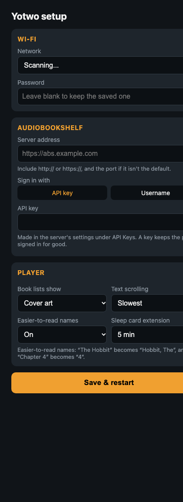

# Getting started

From a Yoto Player Gen 2 on its original firmware to yotwo playing your
Audiobookshelf library. Read it all the way through once before you start.

- [What you need](#what-you-need)
- [1. Open the player and solder a header](#1-open-the-player-and-solder-a-header)
- [2. A way into bootloader mode](#2-a-way-into-bootloader-mode)
- [3. Back up the original firmware](#3-back-up-the-original-firmware)
- [4a. Flash a release](#4a-flash-a-release) or [4b. build from source](#4b-build-from-source)
- [5. First start: Wi-Fi and sign-in](#5-first-start-wi-fi-and-sign-in)
- [Updating later](#updating-later)
- [Going back to the original firmware](#going-back-to-the-original-firmware)
- [Troubleshooting](#troubleshooting)

> **At your own risk.** This voids any warranty. You'll be working inside a
> device with a lithium battery, so don't short anything across it. Take the
> backup in step 3.

## What you need

| | |
|---|---|
| **Player** | Yoto Player, 2nd generation: the full-size player with the 16 × 16 LED display, two knobs and the pogo-pin charging dock. A microSD card is already inside |
| **USB-to-serial adapter** | Any **3.3 V** one: CP2102, CH340, FT232… Not 5 V logic |
| **Soldering** | Iron, solder, a strip of 2.54 mm header pins, jumper wires |
| **Boot/reset** | Two small push buttons on a scrap of board (step 2), or just a jumper wire |
| **Tools** | <!-- TODO(author): which screwdriver/bit opens the player? Any clips or glue? --> **[To add: the screwdriver bit needed]** |
| **Computer** | macOS or Linux runs the scripts directly. On Windows, use the esptool commands given alongside them (or WSL) |
| **Software** | [uv](https://docs.astral.sh/uv/) (the scripts run esptool through it, so nothing is installed) or `pip install esptool` |
| **Server** | [Audiobookshelf](https://www.audiobookshelf.org/), reachable from your Wi-Fi |

## 1. Open the player and solder a header

<!-- TODO(author): describe opening the case: screws, clips, the ribbon/cables to watch, how the board comes out. -->

**[To add: how to open the case]**

> **[Photo to add: the opened player, showing where the board sits]**
> <!-- docs/media/photo-opened.jpg -->

The ESP32's serial port and boot pins are reached through test pads on the
main board. You need five connections:

| Signal | ESP32 pin | Connects to |
|---|---|---|
| GND | GND | Adapter GND |
| TX | GPIO 1 (U0TXD) | Adapter **RX** |
| RX | GPIO 3 (U0RXD) | Adapter **TX** |
| BOOT | GPIO 0 | Boot button (to GND) |
| RESET | EN (CHIP_PU) | Reset button (to GND) |

TX and RX cross over: the player's TX goes to the adapter's RX.

<!-- TODO(author): which pads on the board are these? Label them on the photo. Did you also wire 3V3? -->

> **[Photo to add: the board's pads for GND, TX, RX, GPIO0 and EN, labelled]**
> <!-- docs/media/photo-pads.jpg -->

> **[Photo to add: the header pins soldered on]**
> <!-- docs/media/photo-header.jpg -->

Tips:

- Solder short wires from the pads to a header that you can reach with the
  case closed, or leave it with the back off while you work.
- Keep the wires short. These boards' serial links are noisy even at 115200
  baud, and long flying leads make it worse.
- **Power the player from its own battery and charger** (the dock, or a
  USB-C mod), not from the adapter. Connect only GND, TX and RX to the
  adapter. In bootloader mode no firmware is running to hold the power
  latch, so keep the player on the charger while you flash it.
- **Don't touch GPIO 12.** It's a strapping pin that sets the flash
  voltage; if it's pulled high at reset the board won't boot.

## 2. A way into bootloader mode

The ESP32 starts its serial bootloader instead of the firmware when **GPIO 0
is low as it comes out of reset**. The adapter's DTR/RTS lines aren't
connected to anything on this board, so esptool can't do this by itself
(that's why every command here uses `--before no_reset --after no_reset`).

### Option A: a boot/reset board (recommended)

Two push buttons, each connecting a pin to ground:

```
            BOOT                    RESET
  GPIO 0 ───o  o─── GND     EN ───o  o─── GND
```

The board already has pull-ups on both lines, so the two buttons are all you
need. Adafruit's [serial programmer breakout](https://learn.adafruit.com/hacking-the-yoto-music-players/building-a-serial-programmer-breakout)
for the Mini works on the same idea.

> **[Photo to add: the boot/reset board]**
> <!-- docs/media/photo-boot-reset-board.jpg -->

> **[Photo to add: the board connected to the header and the adapter]**
> <!-- docs/media/photo-boot-reset-wired.jpg -->

**To enter bootloader mode:** hold **BOOT**, press and release **RESET**,
then let go of **BOOT**.

### Option B: a jumper wire

No buttons: hold the GPIO 0 pad to GND with a jumper wire, reset the chip
(touch EN to GND for a moment, or switch the player off and on with the power
button while it's on the charger), then take the jumper off.

### Check it worked

```sh
uvx --from esptool esptool.py --chip esp32 --port PORT --baud 115200 \
    --before no_reset --after no_reset chip_id
```

`PORT` is your adapter: `/dev/cu.usbserial-XXXX` on macOS, `/dev/ttyUSB0` on
Linux, `COM3` (or similar) on Windows. Without uv, `esptool.py` (or
`esptool`) on its own works the same.

You should see `Chip is ESP32-D0WD…` and the MAC address. If esptool can't
connect, enter bootloader mode again and retry. Also check that TX and RX
cross over.

**After any failed esptool command, enter bootloader mode again before the
next one.** A command that fails can leave the chip in a state where it won't
answer.

## 3. Back up the original firmware

Strongly recommended: it's the only way back to the original firmware. Each
player's flash holds its own device certificate and keys, so another player's
backup won't do.

```sh
git clone https://github.com/tomekent/yotwo.git
cd yotwo
tools/backup.sh            # add --port PORT if you have more than one adapter
```

It reads the 8 MB flash in sixteen 512 KB pieces, and takes about 13 minutes
at 115200 baud. Each piece is checked against the chip, so a bad read is
rejected rather than saved. If a piece fails (the link drops bytes now and
then), enter bootloader mode again and run `tools/backup.sh` again: it carries
on from where it stopped. The result is `yotwo-backup-<MAC>.bin`.

To check a finished backup against the chip without reading it all again:

```sh
uvx --from esptool python tools/verify_backup.py yotwo-backup-<MAC>.bin PORT
```

> **Keep the backup private.** It contains your Wi-Fi password and the
> player's own credentials. Don't upload it anywhere.

On Windows, without the scripts:
`esptool.py --chip esp32 --port COM3 --baud 115200 --before no_reset --after no_reset read_flash 0 0x800000 backup.bin`.
This does it in one go, so you may need a few tries.

## 4a. Flash a release

The simplest route needs no toolchain.

**With the script** (macOS/Linux), in bootloader mode:

```sh
tools/flash.sh --first
```

This downloads the latest release from GitHub. It erases the original
firmware's settings area, so yotwo starts clean, then writes the bootloader,
partition table and yotwo. `--version 0.5.6-beta` picks another release;
`--list` shows them. If the erase completes but the write can't connect,
enter bootloader mode again and run `tools/flash.sh` (without `--first`).

**By hand** (any OS):

1. Download `yotwo-<version>-cable.zip` from the
   [latest release](https://github.com/tomekent/yotwo/releases/latest) and
   unzip it.
2. In bootloader mode, from that folder:

   ```sh
   esptool.py --chip esp32 --port PORT --baud 115200 --before no_reset --after no_reset \
       erase_region 0x9000 0x7000
   esptool.py --chip esp32 --port PORT --baud 115200 --before no_reset --after no_reset \
       write_flash --flash_mode dio --flash_freq 40m --flash_size 8MB \
       0x1000 bootloader.bin 0x8000 partition-table.bin \
       0x790000 ota_data_initial.bin 0x10000 yotwo-<version>.bin
   ```

   The erase is for the first install only. The write takes two to three
   minutes, and esptool verifies it as it goes.

Then **reset the player** (RESET button, or power it off and on) and go to
step 5.

## 4b. Build from source

See [building.md](building.md) to set up ESP-IDF 5.5.2 and build. Then:

```sh
tools/release.sh           # runs the tests, archives the build under firmware/releases/
tools/flash.sh --first     # flashes that local build (in bootloader mode)
```

## 5. First start: Wi-Fi and sign-in

1. **Wi-Fi.** With no Wi-Fi saved, the player starts a setup network called
   **`Yotwo-XXXX`** and shows a **four-digit code** on its display.
   > **[Photo to add: the player showing the setup code]**
   > <!-- docs/media/photo-setup-code.jpg (or use media/setup_code.png) -->

   Join `Yotwo-XXXX` from a phone; the setup page should open by itself (if
   not, browse to `http://192.168.4.1`). Enter the code, pick your Wi-Fi,
   type its password and save. The player restarts and joins your network.

   

2. **Sign in to Audiobookshelf.** The display now scrolls
   `SIGN IN AT YOTWO.LOCAL`. On a phone or computer on the same network, open
   **`http://yotwo.local`**. If you have two players, the second is
   `yotwo-2.local`. If `.local` names don't work on your device, use the
   player's IP address from your router.

   Go to **Settings → Audiobookshelf server**:
   - **Server address**, e.g. `https://abs.example.com` or `http://192.168.1.5:13378`.
   - **API key** (recommended): make one in Audiobookshelf's settings, ideally
     for a user made for the player, without admin rights.
     Or use a **username and password**. Tick *Keep the password on the
     player* to let it sign itself back in when Audiobookshelf ends the session.
   - Enter the four-digit code the player shows to confirm.

   The player checks the details with the server, restarts, and loads your
   library. The first time, it also fetches every book's cover in the
   background, which takes a few minutes for a big library.

3. **Play.** Turn the right knob to browse and press it to choose; the left
   knob is volume, and pressing it plays or pauses. More in
   [using.md](using.md).

## Updating later

Once yotwo is installed, you don't need the cable again (unless something
goes badly wrong):

1. Download **`yotwo-<version>.bin`** from
   [Releases](https://github.com/tomekent/yotwo/releases).
2. On the player's web page: **Settings → Firmware**, choose the file, enter
   the code the player shows, and **Update**.

A new version gets a five-minute trial. It's kept only once it has started
properly: the web page answers and the display is running. Otherwise the
player goes back to the version it had. You can also go back by hand:

- **Web page:** Settings → Firmware → *Go back to firmware …*.
- **On the player:** hold **both knobs** while switching it on.
- **By itself:** after three crashes in a row soon after start-up.

## Going back to the original firmware

With the backup from step 3, in bootloader mode:

```sh
tools/restore.sh yotwo-backup-<MAC>.bin
```

This writes the whole 8 MB back (about 13 minutes) and verifies it. On
Windows: `esptool.py --chip esp32 --port COM3 --baud 115200 --before no_reset --after no_reset write_flash 0 backup.bin`.

## Troubleshooting

| Problem | Try |
|---|---|
| esptool: `No serial data received` / `Failed to connect` | The chip isn't in bootloader mode (enter it again), TX/RX aren't crossed, or GND isn't connected |
| esptool: `Invalid head of packet`, `Corrupt data` | Serial noise. Stay at 115200 baud, shorten the wires, enter bootloader mode again and retry |
| `tools/flash.sh`: port in use | Close any serial monitor (or other program) holding the port |
| Stuck on the start-up animation with `WIFI` showing | It can't join Wi-Fi. Hold the right knob to start setup again, or wait |
| `SIGNED OUT - SIGN IN AGAIN` | Audiobookshelf ended the session. Sign in again on the web page, ideally with an API key |
| Player switches off or restarts when Wi-Fi starts | Power: a weak cell or charger. See [hardware.md](hardware.md#power) |
| Some pixels show the wrong colour | Run the display test (web page → Settings → Display). Dead single colours are usually LED or solder faults, often from water damage |
| Watching what it's doing | Serial log at 115200: `tools/idf.sh monitor -p PORT --no-reset`, or any serial terminal |
