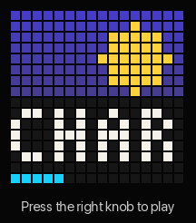
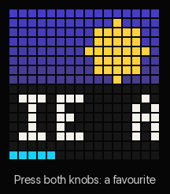
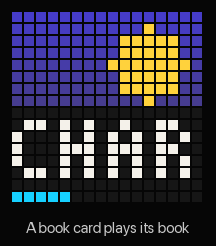
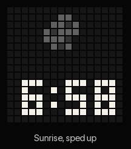
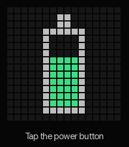

# Using yotwo

The display is 16 × 16 pixels, so everything is a picture with up to four
characters at a time. Longer names scroll along the bottom.

## The knobs and buttons

| | Turn | Press | Hold |
|---|---|---|---|
| **Left knob** | Volume | Play / pause | |
| **Right knob**, on the player screen | Chapter screen: turn to pick a chapter, press to go there | Open the menu | Show the clock |
| **Right knob**, in lists and menus | Move | Choose | Back one level |
| **Both knobs together** | | Favourite / unfavourite the book shown (or playing). With an unlinked card in the slot: link the card to that book | |
| **Power button** | | A tap shows the battery | Switch off |

Switching on with **both knobs held** goes back to the previous firmware
version (see [Updating](#updating)).

## The menu

Press the right knob on the player screen:

| Item | Shows |
|---|---|
| `LAST` | Books you've played, most recent first |
| `NEW` | The 50 most recently added |
| `FAV` | Your favourites in this library |
| `DOWN` | Books downloaded to the SD card (playable offline) |
| `A-Z` | The alphabet: pick a letter to jump into all titles there |
| `AUTH` | Authors, then their books |
| `SERI` | Series, then their books in order |
| `BED` | Sleep timer: off, 15, 30 or 60 minutes |
| `SET` | Settings, below |

Every list looks the same: a picture on top (the cover, or an icon), the name
along the bottom, and a thin cyan line showing where you are in the list.
Lists wrap round. A green dot in the top-left corner marks what's in use, and
a small red heart marks a favourite.

## Settings (`SET`)

| Setting | Does |
|---|---|
| `LIB` | Switch Audiobookshelf library |
| `VIEW` | Lists as cover art (`ART`) or text (`TEXT`) |
| `READ` | Easier-to-read names: "The Gruffalo" becomes "Gruffalo, The", and "Chapter 12: The Wand" becomes "12: The Wand" |
| `SPD` | How fast names scroll: `MIN`, `SLOW`, `MED`, `FAST` |
| `CARD` | The card in the slot: make it a sleep card, or forget it |
| `EXT` | How long taking a sleep card out and back in extends the timer |
| `CLK` | Clock: `HOUR` (12/24-hour), `RISE` and `DUSK` (sunrise and sunset times), `FADE` (how long each takes) |
| `BRT` | Display brightness by day and by night |
| `AUTO` | Switch off on battery after a while (or never) |
| `VOL` | Volume limit |
| `LITE` | LED ring: nightlight on/off, colour, brightness, sunrise wake light |
| `WIFI` | Start Wi-Fi setup again (shows the setup code; any button leaves) |

## Favourites and downloads

Press both knobs on a book to make it a favourite (a heart swells) or to
unfavourite it (an empty heart shrinks). Favourites are mirrored to a
"Favourites" collection on your Audiobookshelf server, so they also show up
in the Audiobookshelf apps.

Favourites, and books linked to cards, are **downloaded to the SD card** in
the background, one at a time, while the player is idle, on the charger and
online. The web page's Downloads tab shows progress and lets you remove
copies.

**Offline:** when Wi-Fi has been gone for 20 seconds, a crossed-out Wi-Fi
symbol appears and every list shows only downloaded books. Positions are sent
back to the server when Wi-Fi returns.

## Cards

Cards are optional. Nothing is written to a card: the player remembers the
card's ID. Original Yoto cards, blank NTAG stickers and most other NFC tags
work.

- **Book card:** put an unlinked card in the slot, find a book (in a list, or
  play it), and press both knobs. From then on, putting the card in plays that
  book, even from another library, and taking it out pauses.
- **Sleep card:** with the card in the slot, `SET` → `CARD` → `SLP`, then
  choose the minutes. Putting it in dims the display, starts the sleep timer
  and carries on with the last book. Taking it out pauses; putting it back
  resumes. If the timer has run out, taking it out and putting it back gives
  a few more minutes (`EXT`).
- **Forget a card:** `SET` → `CARD` → `CLR`, or *Unlink* on the web page.

## Clock and LED ring

With nothing playing and no knob touched for 30 seconds, the player shows a
clock. A sun or moon on top rises and sets with the sunrise and sunset times
in `CLK`, and the time is shown underneath. Hold the right knob on the player
screen to show it straight away. The time comes from the internet, so it needs
Wi-Fi after each switch-on.

**Nightlight:** turn the player face down and the display goes dark while the
ring lights in your chosen colour. Playback carries on.

**Wake light:** if turned on, the ring rises in warm orange with the clock's
sunrise and stays on for a few minutes. Any button turns it off. It needs the
player to be on: set `AUTO` to `NONE`, or leave it on the charger.

**Battery:** a tap of the power button shows the battery for three seconds,
and plugging in the charger shows it with a lightning bolt.

## The web page

Open **`http://yotwo.local`** from a device on the same network. With two
players, the second is `yotwo-2.local`.

| Tab | |
|---|---|
| **Now** | What's playing, battery, Wi-Fi, library, SD card, memory, version |
| **Downloads** | Books kept on the SD card, with progress; remove or keep again |
| **Cards** | Linked cards and what they play; unlink |
| **Settings** | Player name, display (brightness, test), scrolling, volume limit, switch-off, clock, nightlight and wake light, **Audiobookshelf server and sign-in**, **firmware update**, formatting the SD card |
| **Files** | Browse the SD card |

Changing the sign-in, updating firmware and formatting the card all ask for a
four-digit code shown on the player's display, so only someone holding the
player can do them.

The page is plain HTTP on your local network. It refuses requests from other
websites, but anyone on your network could read what it sends.

## Updating

Download `yotwo-<version>.bin` from
[Releases](https://github.com/tomekent/yotwo/releases), then on the web page
go to Settings → Firmware → Update. The player tries the new version, and goes
back to the old one by itself if it doesn't start up properly. More in
[getting-started.md](getting-started.md#updating-later).
